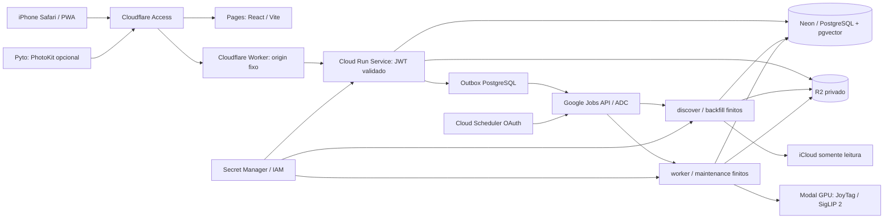

# Arquitetura Photo Intelligence Cloud · implementação auditada

> **Referência arquitetural atualizada (04/11/2026, base `22c01bc`):** consulte [a arquitetura de referência](docs/architecture/SYSTEM_OVERVIEW.md) para a topologia implementada, as fronteiras de segurança e as diferenças entre código e produção. Este guia preserva procedimentos e evidências históricas; confirme sempre as flags, o ambiente implantado e as permissões reais antes de executar comandos.

A migração mantém FastAPI, React/Vite, schema PostgreSQL, fila durável, JoyTag,
SigLIP 2, R2, taxonomia, Bridge e design existentes. Cloud Run/Neon tornam-se o
destino principal preparado para produção; Compose continua local e Oracle/VPS
permanece fallback até validar a implantação real.

O UUID interno identifica uma mídia. Identificadores iCloud, resource ID,
PhotoKit local ID e PHCloudIdentifier são observações distintas vinculadas por
mapeamentos verificados. Filename, timestamp ou pHash semelhante não autorizam
merge ou escrita Apple. Revisões de conteúdo, representação, entrada de inferência,
modelo, metadados e Bridge têm papéis separados.

## Sumário técnico navegável

| Área | Documento auditado |
|---|---|
| Arquitetura e confiança | [SYSTEM_OVERVIEW](docs/architecture/SYSTEM_OVERVIEW.md) |
| Componentes, dependências, pastas | [COMPONENTS_AND_STACK](docs/architecture/COMPONENTS_AND_STACK.md) |
| Descoberta iCloud, manifests, pipeline e autorreparo | [INGESTION_AND_RECOVERY](docs/architecture/INGESTION_AND_RECOVERY.md) |
| Cloudflare, GCP, Neon, R2, Modal e workflows | [INFRASTRUCTURE_AND_DEPLOY](docs/architecture/INFRASTRUCTURE_AND_DEPLOY.md) |
| Banco, recursos, busca e embeddings | [DATA_AND_INFERENCE](docs/architecture/DATA_AND_INFERENCE.md) |
| JWT, IAM, segredos, sessões e R2 | [SECURITY_AND_SECRETS](docs/architecture/SECURITY_AND_SECRETS.md) |
| Logs, Sentry, Notify, Telegram e custos | [OBSERVABILITY_AND_OPERATIONS](docs/architecture/OBSERVABILITY_AND_OPERATIONS.md) |
| Web, Manage, PWA e Apple Bridge | [FRONTENDS_AND_BRIDGE](docs/architecture/FRONTENDS_AND_BRIDGE.md) |
| Evidências e lacunas | [IMPLEMENTATION_REFERENCE](docs/architecture/IMPLEMENTATION_REFERENCE.md) |

## Fronteira de estado e execução

A API é stateless, pode escalar a zero e usa billing por requisição. Não inicia
worker, cron ou tarefa dependente de continuar após a resposta. Cloud Scheduler
chama a API autenticada `jobs:run` com OAuth para discover, worker e maintenance;
backfill exige ação manual. A implantação deixa os agendamentos pausados.

Cloud Run Jobs encerram após workload/deadline finitos e tratam SIGTERM.
PostgreSQL mantém trabalho, checkpoints, prioridade, retry, leases, heartbeat,
fencing tokens e idempotência. Duas invocações podem existir sem duplicar efeitos.
O outbox persiste a intenção de invocação na transação da operação e tenta
entrega autenticada fora dela. ADC usa a identidade de serviço, sem chave JSON.
Migration é um Job separado, serializado e com conexão direta; não roda no startup
concorrente de instâncias da API.

As transações que reivindicam trabalho ou gravam resultados são curtas. Apple,
R2, decoding e Modal operam fora dessas transações. Um resultado só é confirmado
se o worker ainda possui lease/token e a revisão de entrada permanece atual.
Uploads anteriores ao commit podem deixar órfãos: o catálogo e os registros de
intenção controlam reconciliação, sem deletar originais ou ignorar objetos ativos.

## Fluxo de ingestão e inferência

1. A API autoriza o limite solicitado, distinguindo default, expansão confirmada,
   máximo autorizado e hard cap. A execução recebe esse limite validado; não o
   reduz silenciosamente. Instalação nunca inicia importação ilimitada.
2. A descoberta persiste scan, manifesto revisionado e checkpoint. A indisponibilidade
   de uma mídia não desfaz as descobertas nem o trabalho concluído de outras.
3. Jobs por asset controlam download, tentativas, backoff com jitter, quarentena e
   erros classificados. Backfill e incremental têm estado próprio; enumeração
   incompleta não comprova remoção e offset de enumeração não é identidade.
4. O downloader prefere medium, aplica limites de bytes e nunca usa original como
   fallback silencioso. Cache depende de SHA-256 local, revisão, manifesto e marcador
   de conclusão; arquivos `.partial` só viram completos por substituição atômica.
5. O processor normaliza orientação e gera três derivados persistentes e input
   temporário de inferência. EXIF sensível não acompanha imagens entregues ao
   browser; metadados autorizados ficam no banco. Chaves são determinísticas por
   UUID/revisão/variante, sem filenames arbitrários.
6. JoyTag retém propostas/probabilidades e proveniência; SigLIP 2 mantém vetores
   compatíveis de imagem/texto do mesmo checkpoint. Tags manuais/rejeições não são
   sobrescritas pelo reprocessamento. Inputs temporários têm retenção explícita.
7. Busca combina filtros AST limitados, índices textuais, tags e pgvector. O cache
   persistido de texto é vinculado a modelo/revisão/preprocessing e consulta
   normalizada, com TTL, cap e coordenação de concorrência. Sem inferência disponível,
   filtros exatos e texto continuam utilizáveis sem scores semânticos fabricados.

## Banco e capacidade

`DATABASE_POOL_MODE=transaction` usa NullPool e desativa caches de prepared
statements para o endpoint Neon pooled. O modo direto continua compatível com
PostgreSQL padrão e pool pequeno, overflow zero. Produção exige TLS com validação
de CA/hostname; migração e backup usam o endpoint direto.

O perfil limitado tem cap explícito de catálogo; o perfil completo exige banco
dimensionado. Vetores 768D, HNSW, dezenas de tags por foto, resultados brutos,
auditoria e jobs ocupam espaço além de `assets`. Benchmarks sintéticos descartáveis
medem tamanhos e latências, sem prometer throughput real de Apple ou Neon Free.
Veja [NEON_SETUP.md](NEON_SETUP.md) e [COST_MODEL.md](COST_MODEL.md).

## Autenticação e mídia privada

Cloudflare Access protege Pages e o proxy, mas a API também valida cada JWT:
assinatura, issuer, audience e identidade permitida. O origin `run.app` é
publicamente alcançável; isso não é uma rede privada. Acesso sem JWT válido não
recebe fotos, metadados, busca, administração ou sync. Headers de email e forwarded
arbitrários não provam identidade. Bridge exige Access service-auth compatível e
uma credencial própria, revogável, do dispositivo. Secrets nunca chegam à PWA.

A mídia usa proxy autenticado com streaming limitado, ranges/condicionais e
ETag por revisão. Não existe cache público de fotos privadas, e o service worker
não guarda imagens/API privadas. R2 permanece privado. Proteção de previews Pages,
fluxo Safari/reatenticação e origem direta têm protocolos de verificação próprios.

## Sessões, backup e Apple

Cookies Apple são snapshots AES-GCM em objeto privado imutável. Secret Manager
guarda a chave; PostgreSQL guarda pointer, geração, lease e fencing. Cada Job
reidrata arquivos 0700/0600 apenas durante a execução, publica mudanças com CAS e
limpa o texto em claro. Login/2FA inicial exige terminal; nunca senha na API.
[ICLOUD_SESSION_SETUP.md](ICLOUD_SESSION_SETUP.md) detalha bootstrap e rotação.

Backup v2 inclui dump consistente, schema, taxonomia/modelos/configuração
redigida e **bytes** dos derivados em chunks AES-GCM portáteis, com SHA-256 e
restore para banco/storage isolados. Listar objetos não é backup de conteúdo.
Veja [DISASTER_RECOVERY.md](DISASTER_RECOVERY.md).

Tags Apple/modelo/usuário conservam origens separadas. Operações de Bridge exigem
revisão esperada, mapeamento verificado, aprovação manual, preview/diff e auditoria.
O adapter Pyto preserva leitura de inventário; escrita de keywords permanece
indisponível até verificação real de API/runtime/hardware. Apply local não prova
propagação ao iCloud. A ausência de Bridge não interrompe o catálogo cloud.

Não existem rotinas de exclusão de originais, substituição da biblioteca ou
escrita em massa automática. Duplicatas são grupos de revisão não destrutivos.
A autorização manual foi simplificada: até 1.000 fotos não há bloqueio por
gates; operações novas maiores exigem apenas a autorização F de escala,
com evidências e SHA da API. Limites de lote, bytes e capacidade continuam
validados na API e no worker. Deploys independentes de web e API são permitidos.

O detalhamento de recursos e IAM está em
[docs/architecture/CLOUD_RUN_TARGET.md](docs/architecture/CLOUD_RUN_TARGET.md);
[OPERATIONS.md](OPERATIONS.md) reúne operação e recuperação pelo iPhone.
