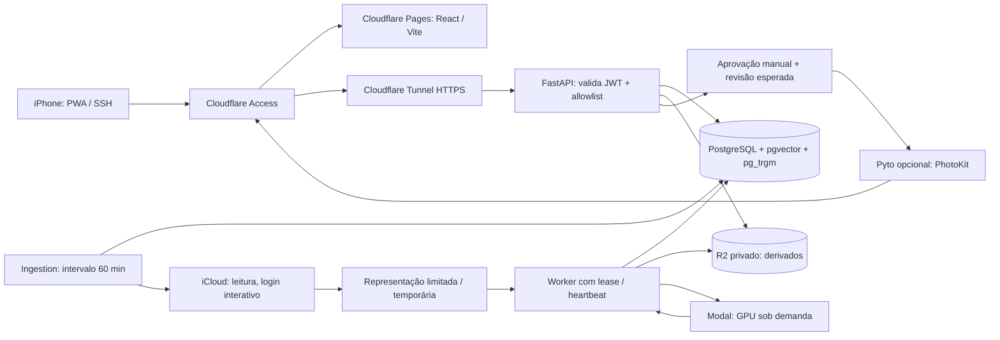

# Arquitetura

O UUID interno de uma mídia identifica o catálogo. Identificadores iCloud e
PhotoKit são observações de fontes distintas, vinculadas por mapeamentos
verificados. Nomes de arquivos ou posições numa enumeração não são identidade.

O ambiente local substitui R2 por MinIO e executa frontend/API numa origem via
proxy nginx. Produção pode publicar o bundle no Pages e disponibilizar a API por
um hostname próprio no Tunnel; configurar CORS e credenciais entre as origens
explicitamente é obrigatório. A PWA não recebe credenciais Cloudflare/R2/Modal.

## Fluxo de uma representação

1. A ingestão enumera a biblioteca, registra chave e revisão da fonte e decide
   se há conteúdo novo. Ausência numa varredura incompleta não significa exclusão.
2. O downloader tenta a representação configurada (`medium` por padrão), aplica
   limites de bytes e registra indisponibilidade. Original exige configuração
   explícita; não há fallback silencioso.
3. O worker cria thumbnails, preview e entrada de inferência. Rotação EXIF,
   formato real e dimensões precisam ser tratados antes da classificação.
4. Derivados vão para armazenamento privado; o banco guarda referência, revisão,
   SHA-256, tamanho e MIME. O navegador recebe acesso autorizado de curta duração.
5. Jobs registram tentativas, lease, heartbeat, progresso e erros. Reiniciar um
   processo recupera trabalho por estado persistido; não gera uma fila invisível.
6. JoyTag produz propostas com confiança e origem; SigLIP2 produz embeddings do
   checkpoint/revisão compatíveis. Revisões de conteúdo/modelo controlam reprocessamento.

## Aprovação e preservação

Tags Apple, do modelo e do usuário mantêm proveniência. Aceitar/rejeitar uma
proposta não elimina a observação original. Operações destinadas ao dispositivo
têm revisão esperada, idempotência, vínculo verificado e auditoria. Uma aprovação
não demonstra propagação ao iCloud: são estados diferentes.

Originais são imutáveis para este sistema. Não existem rotinas de exclusão
remota ou varredura de limpeza da biblioteca. A limpeza local só alcança o
diretório `processing`, com retenção explícita. Duplicatas são agrupamentos para
revisão; nenhum botão ou worker apaga a foto de origem.

## Fronteiras de confiança

Cloudflare Access protege os hostnames, e a API verifica assinatura JWT, issuer,
audience e email allowlist. Um cabeçalho contendo email não prova identidade.
PostgreSQL não tem porta pública em produção. O bucket não possui acesso
anônimo, a sessão iCloud tem diretório 0700 e o arquivo `.env` tem modo 0600.
Logs registram identificadores e erros estruturados sem cookies, senhas,
tokens, URLs assinadas ou payloads privados completos.

Container API/worker roda como UID 10001, com filesystem raiz somente leitura,
capabilities removidas e diretórios de trabalho específicos. Não há Docker
socket exposto ao aplicativo. Tunnel inicia conexões de saída; o servidor não
precisa publicar HTTP/HTTPS diretamente na Internet.

## Capacidade e expansão

Uma biblioteca inicial de 176 mil mídias é uma dimensão de planejamento, não
uma capacidade já medida. Busca textual usa GIN/trigram; listagens usam índices
de cursor; busca vetorial usa HNSW com separação por modelo/revisão. Benchmarks
de 10 mil, 100 mil, 176 mil e 500 mil devem registrar planos, hardware, versões,
tamanho de índices e latências reais. Ajustar recursos Oracle depende do que a
conta consegue provisionar e do disco disponível, sem assumir cotas gratuitas.
