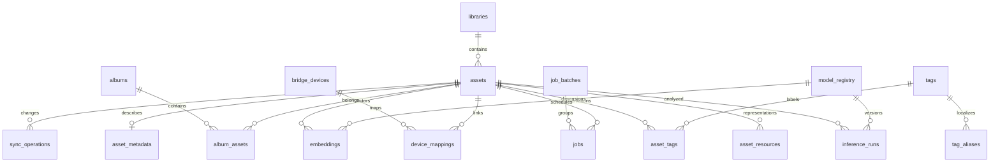

# Banco de dados

PostgreSQL 16 com extensões `vector` e `pg_trgm`; SQLAlchemy 2 usa `asyncpg`.
Alembic aplica migrações em `infra/migrations`. Datas são UTC, IDs de entidades
são UUID e JSONB guarda metadados versionáveis sem substituir chaves e índices.

Em produção `APP_DATABASE_URL` aponta a um papel LOGIN sem SUPERUSER, CREATEDB,
CREATEROLE ou BYPASSRLS, autorizado a CRUD/uso de sequências do catálogo.
`MIGRATION_DATABASE_URL` usa credencial separada para extensões/DDL e só é
injetada no container `migrate`. `.env.runtime` não contém segredos administrativos.
Veja o provisionamento explícito em `infra/oracle/provision-app-role.sh` e
[docs/deployment/oracle-arm.md](docs/deployment/oracle-arm.md).

## Entidades

| Grupo | Tabelas | Papel |
|---|---|---|
| Fonte e mídia | `libraries`, `assets`, `asset_resources`, `asset_metadata` | Biblioteca, identidade, revisões, representações e EXIF |
| Vocabulário | `tags`, `tag_aliases`, `asset_tags` | Chave canônica, nome/alias localizado, origem e revisão |
| Inferência | `model_registry`, `inference_runs`, `embeddings` | Checkpoint exato, execução idempotente e vetor |
| Execução | `jobs`, `job_batches`, `job_events`, `worker_states`, `ingestion_runs` | Fila, lotes, eventos, heartbeat e descoberta |
| Apple | `bridge_devices`, `device_mappings`, `metadata_snapshots`, `sync_operations` | Dispositivo, identidade verificada, revisão e aprovação |
| Organização | `albums`, `album_assets`, `duplicate_groups`, `duplicate_members`, `saved_searches` | Álbuns, duplicatas e consultas |
| Configuração/auditoria | `settings`, `audit_events` | Parâmetros públicos e histórico de ações |



## Invariantes e estados

`(library_id, source_asset_key)` é único. Recurso é único por
`(asset_id, resource_type, revision)`; inferência e embedding usam
`(asset_id, model_id, input_revision)`. Jobs e operações de sync têm chave de
idempotência única. Dimensão do vetor é 768 para o SigLIP2 especificado;
trocar checkpoint/dimensão exige migração e índice correspondente.

`visibility_status` é `active`, `unavailable`, `missing_candidate`,
`confirmed_missing` ou `archived`. Confirmar ausência exige varreduras completas
repetidas; arquivamento é estado do catálogo, não deleção da origem.
Uma proposta JoyTag retém confiança e revisão do modelo. Correções do usuário
mantêm origem `user` e não destroem registros das demais fontes.

## Índices e consultas

Há índices por biblioteca/status, cursor de captura/criação, tipo/dimensões,
hash de conteúdo, tag/origem/confiança e estado/agendamento da fila. Texto usa
GIN sobre tsvector e trigram para nome/filename. O índice HNSW usa distância
cosseno; avalie seletividade dos filtros e recall em cada escala antes de ajustar
`ef_search` ou parâmetros de construção. Índice existente não prova plano usado.

Evite `OFFSET` profundo em listagens e mantenha a ordem com desempate UUID.
`EXPLAIN (ANALYZE, BUFFERS, FORMAT JSON)` deve acompanhar medições em banco
sintético. Planos e relatórios de uma biblioteca pessoal contêm nomes/metadados:
trate-os como privados.

## Migração e recuperação

```bash
make backup
make migrate
make restore-test
```

Teste migrações e restauração primeiro num banco descartável. O backup completo
`postgres.dump` preserva inclusive embeddings; CSV/JSON de portabilidade excluem
vetores volumosos. R2/MinIO não integra o `pg_dump`: retenção/versionamento dos
objetos e cópia de recuperação precisam de procedimento separado.
Não restaure um dump sobre a base em uso. [OPERATIONS.md](OPERATIONS.md) descreve
seleção do destino, verificação de hashes e recuperação controlada.
