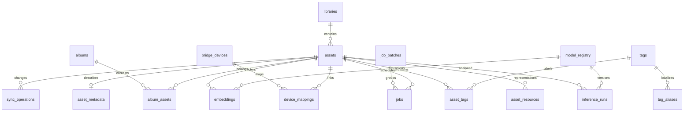

# Banco de dados

> **Referência arquitetural atualizada (04/11/2026, base `22c01bc`):** consulte [a arquitetura de referência](docs/architecture/DATA_AND_INFERENCE.md) para a topologia implementada, as fronteiras de segurança e as diferenças entre código e produção. Este guia preserva procedimentos e evidências históricas; confirme sempre as flags, o ambiente implantado e as permissões reais antes de executar comandos.

PostgreSQL com extensões `vector` e `pg_trgm`; SQLAlchemy 2 usa `asyncpg`.
O desenvolvimento e os testes usam PostgreSQL 16. Neon é o destino gerenciado
preferencial; a conexão remota depende da configuração e validação do operador.
Alembic aplica migrações em `infra/migrations`. Datas são UTC, IDs de entidades
são UUID e JSONB guarda metadados versionáveis sem substituir chaves e índices.

Em produção `APP_DATABASE_URL` aponta a um papel LOGIN sem SUPERUSER, CREATEDB,
CREATEROLE ou BYPASSRLS, autorizado a CRUD/uso de sequências do catálogo.
`MIGRATION_DATABASE_URL` usa credencial separada para extensões/DDL e só é
injetada no container `migrate`. `.env.runtime` não contém segredos administrativos.
No Cloud Run, `DATABASE_URL` usa o endpoint pooled, TLS com verificação e
`DATABASE_POOL_MODE=transaction`; a migração usa o endpoint direto separado.
O pool padrão possui duas conexões e zero overflow; o modo transaction usa
`NullPool`, sem estado de sessão entre transações. Veja [NEON_SETUP.md](NEON_SETUP.md).
O provisionamento VPS continua em `infra/oracle/provision-app-role.sh` e
[docs/deployment/oracle-arm.md](docs/deployment/oracle-arm.md).

## Entidades

| Grupo | Tabelas | Papel |
|---|---|---|
| Fonte e mídia | `libraries`, `assets`, `asset_resources`, `asset_metadata` | Biblioteca, identidade, revisões, representações e EXIF |
| Vocabulário | `tags`, `tag_aliases`, `asset_tags` | Chave canônica, nome/alias localizado, origem e revisão |
| Inferência | `model_registry`, `inference_runs`, `embeddings` | Checkpoint exato, execução idempotente e vetor |
| Execução | `jobs`, `job_batches`, `job_events`, `worker_states`, `ingestion_runs` | Fila, lotes, eventos, heartbeat e descoberta |
| Apple | `bridge_devices`, `device_mappings`, `metadata_snapshots`, `sync_operations` | Dispositivo, identidade verificada, revisão e aprovação |
| Organização | `albums`, `album_assets`, `duplicate_groups`, `duplicate_members`, `saved_searches` | Álbuns, duplicatas e consultas |
| Configuração/auditoria | `settings`, `audit_events` | Parâmetros públicos e histórico de ações |
| Descoberta v1.1 | `discovery_scans`, `discovery_manifests` | Checkpoints, revisões e falhas independentes |
| Recuperação v1.1 | `durable_leases`, `object_intents`, `dispatch_outbox` | Fencing, uploads recuperáveis e despacho finito |
| Sessões v1.1 | `icloud_session_states` | Ponteiro para snapshot criptografado, geração e CAS |
| Busca v1.1 | `query_embedding_cache` | Cache limitado por modelo, revisão e preprocessing; sem texto da consulta |
| Validação v1.1 | `verification_gates` | Evidência manual vinculada ao SHA exato do release |



## Invariantes e estados

`(library_id, source_asset_key)` é único. Recurso é único por
`(asset_id, resource_type, revision)`; inferência e embedding usam
`(asset_id, model_id, input_revision)`. Jobs e operações de sync têm chave de
idempotência única. Dimensão do vetor é 768 para o SigLIP2 especificado;
trocar checkpoint/dimensão exige migração e índice correspondente.

`model_registry.preprocessing_revision` separa vetores produzidos por runtimes
distintos. A migração `0007_model_preprocessing` preserva registros existentes
no namespace `legacy-v1`. O runtime Transformers 5.10.2 registra outro `model_id`;
buscas e cache exigem o mesmo namespace. Vetores antigos continuam armazenados;
reindexação exige ação explícita e os controles de orçamento permanecem ativos.

A aplicação e os workers anteriores à v1.1 devem ser pausados na passagem para
0007: a chave única de modelo passa a incluir preprocessing. Não faça uma
implantação misturando esses writers. O downgrade recusa namespaces que
colidiriam na chave antiga; ele não mescla nem apaga inteligência para forçar
rollback. Preserve backup/restauração antes da migração.

Jobs possuem `fence_token` monotônico. Somente o dono da lease não expirada pode
persistir resultados; um retry não aceita commits de um worker anterior.
Uploads usam chaves imutáveis e um `object_intent` persistido antes do I/O.
Manifests possuem unicidade `(library_id, source_key, content_revision)`.
O contador de admissão do catálogo em `settings` é reconciliado uma vez por
execução e atualizado na mesma transação de cada novo asset, sem COUNT por foto.

As migrações 0005 e 0006 adicionam esses componentes sem resetar dados. O Job
de migração usa conexão direta e lock de serialização; o startup da API não
executa Alembic. [DISASTER_RECOVERY.md](DISASTER_RECOVERY.md) descreve backup
criptografado com conteúdo dos objetos e verificação de restauração.

`visibility_status` é `active`, `unavailable`, `missing_candidate`,
`confirmed_missing` ou `archived`. Confirmar ausência exige varreduras completas
repetidas; arquivamento é estado do catálogo, não deleção da origem.
Uma proposta JoyTag retém confiança e revisão do modelo. Correções do usuário
mantêm origem `user` e não destroem registros das demais fontes.

## Índices e consultas

Há índices por biblioteca/status, cursor de captura/criação, tipo/dimensões,
hash de conteúdo, tag/origem/confiança e estado/agendamento da fila. Texto usa
GIN sobre tsvector e trigram para nome/filename. O índice HNSW usa distância
cosseno; avalie seletividade dos filtros e recall em cada escala antes de ajustar
`ef_search` ou parâmetros de construção. Índice existente não prova plano usado.

A migração `0004_filename_search_tokens` mantém o nome original e indexa também
as palavras separadas por pontuação. Assim `garden.jpg`, `summer_beach-2020.jpeg`
e nomes sintéticos de benchmark respondem a termos como `garden` e `beach`.
O trigger de inserção/renomeação e a atualização de tags usam a mesma função
`photointel_filename_document`; tags sensíveis/rejeitadas continuam excluídas
do documento textual da aplicação.

Evite `OFFSET` profundo em listagens e mantenha a ordem com desempate UUID.
`EXPLAIN (ANALYZE, BUFFERS, FORMAT JSON)` deve acompanhar medições em banco
sintético. Planos e relatórios de uma biblioteca pessoal contêm nomes/metadados:
trate-os como privados.

## Migração e recuperação

```bash
make backup
make migrate
make restore-test
```

Teste migrações e restauração primeiro num banco descartável. O backup completo
`postgres.dump` preserva inclusive embeddings; CSV/JSON de portabilidade excluem
vetores volumosos. R2/MinIO não integra o `pg_dump`: retenção/versionamento dos
objetos e cópia de recuperação precisam de procedimento separado.
Não restaure um dump sobre a base em uso. [OPERATIONS.md](OPERATIONS.md) descreve
seleção do destino, verificação de hashes e recuperação controlada.
