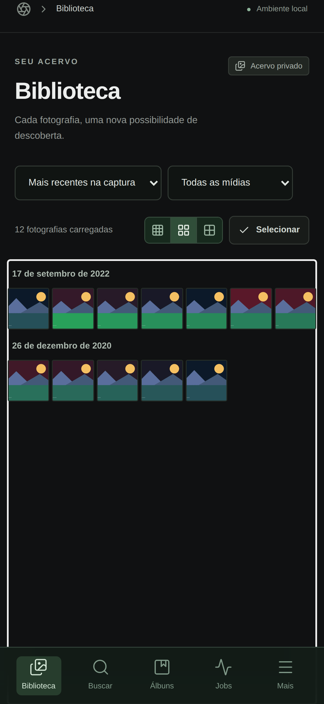

# Photo Intelligence Cloud v1.1

Catálogo privado de fotos e vídeos, preparado para bibliotecas grandes, com tags
revisáveis, busca textual e vetorial, álbuns, fila persistente, diagnóstico de
duplicatas e integração opcional com iCloud. Os originais permanecem no serviço
de origem: o projeto trabalha com representações limitadas e derivados privados.

O destino principal de produção é Cloudflare Pages + Google Cloud Run
Service/Jobs + Neon PostgreSQL + R2 privado + Modal. Compose continua o ambiente
local e Oracle/VPS permanece como fallback. A migração preserva o catálogo,
contratos e design existentes, sem reconstruir a aplicação.

O núcleo funciona em Linux ARM64/AMD64 sem Mac, Xcode ou aplicativo iOS próprio.
O iPhone pode acessar a PWA e operar o sistema por Codespaces, Cloud Shell ou SSH. A ponte Pyto é opcional;
as capacidades reais do dispositivo e qualquer escrita de keywords precisam de
validação e aprovação. Leia [LIMITATIONS.md](LIMITATIONS.md) antes de conectar
uma biblioteca pessoal.

Status verificado: **Local development ready**. Consulte o
[relatório final v1.1](docs/audit/FINAL_REPORT_V11.md) e a
[validação executada](VALIDATION.md) para resultados, commit testado e pré-requisitos
externos. A validação local não aprova a biblioteca completa nem gastos cloud.

## Início local

Requisitos: Python 3.12, uv, Node 22, Docker com Compose v2, armazenamento livre
e acesso aos registros de pacotes/imagens. Em Codespaces, abra o repositório com
`.devcontainer/devcontainer.json` e mantenha as portas encaminhadas **privadas**.

```bash
make setup                    # .env 0600, segredos locais aleatórios, dependências
make dev                      # banco, MinIO, migração, API, worker, ingestion, web
make seed ASSETS=100           # apenas mídias sintéticas
make doctor
```

Abra `http://localhost:5173`; a API usa `http://localhost:8000`. Banco e MinIO
escutam somente em loopback no modo local. O bucket é privado. `make stop`
preserva os volumes; não use `docker compose down -v` em uma biblioteca real.

No Codespaces, abra a porta **5173** pela aba Ports no Safari, com visibilidade
**Private**. A configuração nova detecta sua origem HTTPS e usa o proxy da própria
PWA para `/v1`. Se o `.env` já existia ou o nome do Codespace mudou, execute:

```bash
python3 infra/scripts/setup-env.py --codespaces-origin
make dev
```

Esse comando altera apenas as três configurações de origem e preserva os demais
valores. A origem precisa corresponder à URL aberta no iPhone para que alterações
de tags, álbuns e jobs passem pela proteção CSRF.

### Certificado TLS do build local (`BUILD_CA_FILE`)

`BUILD_CA_FILE` **não é uma credencial para gerar**: é o caminho, na **máquina que roda o Docker Compose**, para um bundle PEM/CRT de autoridades certificadoras confiáveis. O Compose envia o arquivo como secret temporário `build_ca` ao BuildKit, mantendo a verificação HTTPS ligada. No Ubuntu, Codespaces e WSL2:

```bash
ls -l /etc/ssl/certs/ca-certificates.crt
# No .env da raiz:
BUILD_CA_FILE=/etc/ssl/certs/ca-certificates.crt
```

Se o arquivo não existir, instale o pacote `ca-certificates` do Linux; no macOS ou Windows nativo, use o caminho retornado por `python -c "import certifi; print(certifi.where())"` (instale `certifi`) ou prefira o WSL2. Em redes com inspeção HTTPS, use o bundle com a CA aprovada do proxy; não desative TLS. Veja as diferenças por SO em [Cloud Run do zero: ambiente local](docs/deployment/CLOUD_RUN_FROM_ZERO.md#1-desenvolvimento-local-e-build_ca_file).

O modo de autenticação local serve ao desenvolvimento em loopback. Produção
exige JWT criptograficamente validado do Cloudflare Access, allowlist explícita,
HTTPS e R2/S3 privado. O origin `run.app` é publicamente alcançável, mas cada endpoint privado valida o
JWT e falha fechado; a proteção do Pages sozinha não autentica a API. Veja
[CLOUD_RUN_SETUP.md](CLOUD_RUN_SETUP.md), [NEON_SETUP.md](NEON_SETUP.md) e
[CLOUDFLARE_SETUP.md](CLOUDFLARE_SETUP.md). O caminho
[Oracle/VPS](docs/deployment/oracle-arm.md) continua disponível como alternativa.

## Google Cloud Run: do zero ao deploy

**[Guia completo e atualizado, com comandos e telas](docs/deployment/CLOUD_RUN_FROM_ZERO.md).** Ele cobre o que foi necessário para provisionar esta instalação real: APIs, Cloud Shell, Neon/R2, Cloudflare Access, Secret Manager, IAM, bucket de staging, Artifact Registry, WIF do GitHub, workflows, build, migração e rollback.

**Sequência recomendada:**

1. Preparar Google Cloud (projeto `photointel`, `us-central1`, billing/budgets) e contas Neon, Cloudflare Access e R2.
2. Configurar os valores **não secretos** de `GCP_CONFIG_ENV`; segredos reais ficam no Google Secret Manager, não no GitHub.
3. Rodar **`bootstrap` como operador administrativo no Cloud Shell**; ele cria o repositório Docker, bucket, seis service accounts e políticas IAM. Não manter papéis administrativos na identidade CI.
4. Preencher os secrets com prompts ocultos, configurar o pool `github-actions` / provider `photo-intelligence` e conceder WIF **somente** ao repo `rodkisten/photointel`, `main` e ambiente `production`.
5. No GitHub `Settings → Environments → production → Environment variables`, definir a variável multiline **`GCP_CONFIG_ENV`**. O workflow `gcp-deploy.yml` usa `vars.GCP_CONFIG_ENV`, **não** `GCP_CONFIG_JSON`.
6. Executar `build` → `jobs-deploy` via [GitHub Actions](https://github.com/rodkisten/photointel/actions/workflows/gcp-deploy.yml). A migração é **separada**, condicionada a banco comprovadamente vazio ou backup/restauração verificados. Depois executar `deploy` → configurar Worker/Pages + Access → `scheduler` (cron jobs começam pausados).
7. Testar autenticação e rotas privadas, revisar custos e só então liberar imports, iCloud, GPU e agendamentos conforme os gates de segurança.

O `gcp-validation.yml` testa offline, sem credenciais Google. O `gcp-deploy.yml` só executa manualmente na `main` com confirmação de projeto, ambiente `production` e autorização explícita de custos. Consulte também [CLOUD_RUN_SETUP.md](CLOUD_RUN_SETUP.md) para migrações, Cloudflare e rollback.

## Comandos

| Comando | Resultado/pré-requisito |
|---|---|
| `make setup` | Preserva `.env` existente; instala dependências dos lockfiles |
| `make dev` | Compila e inicia o ambiente Compose local |
| `make migrate` | Aplica Alembic no banco de `DATABASE_URL` |
| `make seed ASSETS=100` | Com Compose ativo, cria mídias sintéticas no volume compartilhado; não lê iCloud |
| `make lint`, `make typecheck` | Verificações Python e TypeScript |
| `make test` | Testes sem integrações externas e testes do frontend |
| `make test-integration` | PostgreSQL real; serviço correspondente precisa estar disponível |
| `make test-e2e` | Playwright; navegador e aplicação precisam estar disponíveis |
| `make build` | Bundle web e imagens API/frontend |
| `make doctor` | Diagnóstico em JSON; integração não configurada é explicitada |
| `make ingest-test` | Exercício do pipeline com fixture sintética |
| `make gpu-test` | Testes marcados GPU; modelos/revisões/hardware reais necessários |
| `make backup` | Backup legado PostgreSQL/exportações; não inclui bytes R2 |
| `make backup-application BACKUP_DIRECTORY=backups/NOVO BACKUP_KEY_FILE=/caminho/privado` | Dump e bytes dos derivados em chunks AES-GCM; requer clientes PostgreSQL |
| `make verify-backup BACKUP_DIRECTORY=backups/NOVO BACKUP_KEY_FILE=/caminho/privado` | Verifica manifesto, criptografia e checksums completos |
| `make restore-application-test POSTGRES_CONTAINER=seu-postgres` | Testa banco e conteúdo de imagens em destinos descartáveis |
| `make restore-test` | Backup/restore de dois bancos sintéticos isolados |
| `make export` | CSV/JSON em `exports/`, sem vetores volumosos |
| `make benchmark ASSETS=10000` | Benchmark em banco sintético, relatório JSON |
| `make cleanup` | Remove somente arquivos temporários expirados em `var/processing` |
| `make capacity-benchmark CAPACITY_ASSETS=1000` | Dataset sintético com tags/vetores; banco descartável obrigatório |
| `make gcp-doctor`, `make gcp-render` | Diagnóstico/plano offline da implantação |
| `make gcp-bootstrap`, `make gcp-build`, `make gcp-jobs-deploy` | Planos de infraestrutura e imagens fixadas ao Git SHA |
| `make gcp-migrate`, `make gcp-deploy`, `make gcp-scheduler` | Planos de migração, Service/Jobs e Scheduler pausado |
| `make gcp-smoke`, `make gcp-rollback` | Validação de segurança/saúde e plano de rollback |

GPU e iCloud começam desativados. Os limites iniciais são lote 8, concorrência 1,
importação 100 mídias, até 20 MiB por download e varredura a cada 60 minutos.
Expansões autorizadas têm limites de execução explícitos e hard cap; gates
persistidos mantêm o backfill completo bloqueado. Descoberta gera manifesto e
jobs individuais, permitindo continuar quando uma foto falha. Cloud Run executa
cargas finitas; a API não hospeda cron ou worker permanente. Sessões Apple são
snapshots AES-GCM com lease/CAS no PostgreSQL, nunca estado durável em `/tmp`.

Neon tem dois perfis: catálogo limitado com cap explícito e biblioteca completa
que exige capacidade medida. Não se presume que Free comporte 176 mil vetores,
tags e índices. As estimativas de custo restringem agendamento; não substituem
limites ou alertas de cobrança do provedor. Revise
[COST_MODEL.md](COST_MODEL.md) e [MODAL_SETUP.md](MODAL_SETUP.md).

Todos os comandos GCP planejam offline por padrão. Criar recursos ou executar
cargas requer `--apply --authorize-charges --confirm-project PROJETO`, após
revisão explícita pelo operador. O desenvolvimento local, os testes e os planos offline não provisionam infraestrutura
paga. Para criar recursos, siga a aprovação operacional e o [guia do zero ao deploy](docs/deployment/CLOUD_RUN_FROM_ZERO.md).

## Preview e validação



Capturas reais da aplicação no viewport de iPhone estão no
[artifact de validação](https://github.com/rodkisten/photointel/actions/runs/38896377983/artifacts/12044595503),
em `reports/previews/`: biblioteca, viewer e painel de metadados. Mostram somente
imagens procedurais do catálogo de teste, sem fotos pessoais. A evidência separada
de [WebKit](docs/evidence/webkit-validation.json) confirma os fluxos no Linux;
Safari e instalação da PWA no aparelho ainda exigem teste físico.

[JoyTag e SigLIP 2 com pesos reais](docs/evidence/real-cpu-model-validation.json)
foram executados em CPU e gravados no PostgreSQL. Isso não equivale a deploy
Modal/CUDA nem a uma integração iCloud autenticada.

## Documentação e evidência

- [ARCHITECTURE.md](ARCHITECTURE.md): componentes, identidade e fluxos.
- [DATABASE.md](DATABASE.md): entidades, índices, evolução e backup.
- [API.md](API.md): autenticação, paginação e contrato HTTP.
- [docs/deployment/CLOUD_RUN_FROM_ZERO.md](docs/deployment/CLOUD_RUN_FROM_ZERO.md): do zero ao deploy: CA local, GCP, IAM/WIF, GitHub Actions, Cloud Run e diagnóstico.
- [CLOUD_RUN_SETUP.md](CLOUD_RUN_SETUP.md): implantação e rollback pelo iPhone.
- [NEON_SETUP.md](NEON_SETUP.md): TLS, pooling, migrações e perfis de capacidade.
- [ICLOUD_SETUP.md](ICLOUD_SETUP.md): login interativo e ingestão.
- [ICLOUD_SESSION_SETUP.md](ICLOUD_SESSION_SETUP.md): cookies criptografados e bootstrap serverless.
- [DISASTER_RECOVERY.md](DISASTER_RECOVERY.md): backup completo de banco/objetos e restore.
- [docs/audit/FINDINGS_STATUS.md](docs/audit/FINDINGS_STATUS.md): achados e evidências v1.1.
- [PYTO_BRIDGE.md](PYTO_BRIDGE.md): capacidades e aprovação no dispositivo.
- [OPERATIONS.md](OPERATIONS.md): operação diária, recuperação e custos.
- [docs/operations/benchmarks.md](docs/operations/benchmarks.md): medições reproduzíveis.
- [LIMITATIONS.md](LIMITATIONS.md): limitações externas e critérios de validação.
- [docs/VALIDATION.md](docs/VALIDATION.md): testes e medições realmente executados.
- [docs/DELIVERY.md](docs/DELIVERY.md): mapa, matriz de capacidades, comandos e checklist iPhone.

Arquivos `reports/` são evidência apenas quando produzidos por uma execução
real. A presença de um workflow, configuração ou teste não significa implantação,
benchmark ou integração Apple/Modal concluída. Nunca publique fotos, cookies,
credenciais ou relatórios com metadados pessoais em um repositório público.
