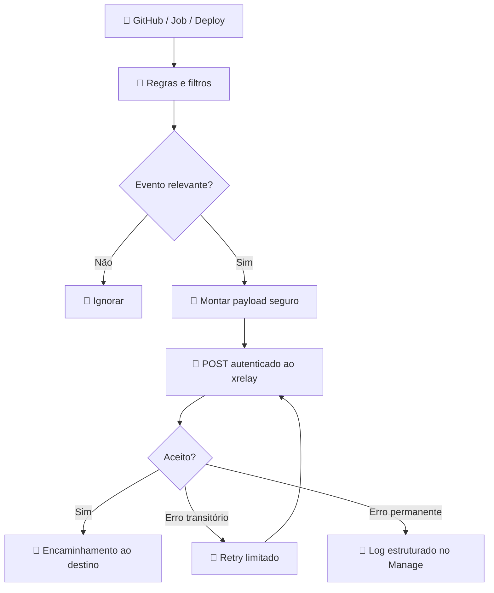

# 🔔 Manage × xrelay: notificações e webhooks

> **Guia operacional** · PhotoIntel Manage · Atualizado em 19/11/2026  
> **Escopo:** integração de eventos do GitHub, pipelines, deploys e jobs com o relay de notificações.  
> **Importante:** os exemplos de `notify.yml` abaixo são modelos de configuração. Confirme o schema implementado no repositório emissor antes de aplicar: campos ilustrativos não constituem contrato de API.

## 🧭 Sumário

- [✨ Visão geral](#-visão-geral)
- [🗺️ Fluxo ponta a ponta](#️-fluxo-ponta-a-ponta)
- [🔐 Autenticação e variáveis](#-autenticação-e-variáveis)
- [📨 Envio HTTP](#-envio-http)
- [🧩 Configuração por repositório](#-configuração-por-repositório)
- [🎨 Templates e exemplos](#-templates-e-exemplos)
- [🧠 Merge e conflitos](#-merge-e-conflitos)
- [🛡️ Segurança e privacidade](#️-segurança-e-privacidade)
- [🔁 Retries, deduplicação e ruído](#-retries-deduplicação-e-ruído)
- [🧪 Testes e diagnóstico](#-testes-e-diagnóstico)
- [🚨 Troubleshooting](#-troubleshooting)
- [✅ Checklist de implantação](#-checklist-de-implantação)
- [📚 Referências](#-referências)

## ✨ Visão geral

O **Manage** é o centro de observabilidade e configuração. O **xrelay** recebe uma mensagem autenticada e a encaminha ao canal configurado. Os emissores podem ser GitHub Actions, webhooks de GitHub, jobs ou serviços de deploy. O recebimento HTTP **não comprova** a entrega final no dispositivo.

| Peça | Responsabilidade |
| --- | --- |
| 🐙 GitHub / Actions | Origem de eventos e metadados de workflow, branch, commit e run |
| 🧰 `notify.yml` | Regras específicas de um repositório e modelos de mensagem, quando suportados pelo emissor |
| 🧭 Manage | Configuração, visibilidade de divergências, histórico e diagnóstico |
| 📡 xrelay | Autenticar, aceitar e encaminhar notificações |
| 📱 Destino | Apresentar a mensagem ao operador |

**Princípio:** preferir uma notificação por **resultado de execução** (sucesso/falha/cancelamento), não uma por step. Sempre incluir o nome do repositório.

## 🗺️ Fluxo ponta a ponta



Não coloque credenciais ou conteúdo confidencial nos títulos, URLs de logs ou mensagens.

## 🔐 Autenticação e variáveis

O README do Manage documenta a configuração do Telegram/relay via `GCP_CONFIG_ENV`:

```dotenv
TELEGRAM_NOTIFICATION_URL=https://xtelegram-cf.migos.club/notifications/send
TELEGRAM_NOTIFICATION_API_TOKEN=<TOKEN_SECRETO>
TELEGRAM_NOTIFICATION_CHAT_ID=<CHAT_ID>
```

São também aceitas variantes com prefixo `EXTRA_ENVIRONMENT__`, com precedência sobre as chaves diretas, conforme o README do Manage. **Nunca** commitar tokens reais. Para automações, preferir secrets do ambiente e injeção apenas em runtime. Distinguir credenciais de GitHub Actions das do Worker Manage: não presumir propagação automática.

| Variável | Finalidade | Sigilo |
| --- | --- | --- |
| `TELEGRAM_NOTIFICATION_URL` | Endpoint de envio do relay | URL operacional |
| `TELEGRAM_NOTIFICATION_API_TOKEN` | Credencial de autenticação | 🔒 Secret |
| `TELEGRAM_NOTIFICATION_CHAT_ID` | Identificador do destino | Dado operacional restrito |

## 📨 Envio HTTP

Exemplo de **teste ilustrativo** com Bearer. O formato exato do JSON deve ser conferido no handler `/notifications/send` do xrelay antes de uso em produção:

```bash
: "${TELEGRAM_NOTIFICATION_API_TOKEN:?Defina o token}"
: "${TELEGRAM_NOTIFICATION_URL:?Defina a URL}"

curl --fail-with-body --show-error --silent \
  --request POST "$TELEGRAM_NOTIFICATION_URL" \
  --header "Authorization: Bearer $TELEGRAM_NOTIFICATION_API_TOKEN" \
  --header "Content-Type: application/json" \
  --data '{
    "title": "✅ photointel · Deploy concluído",
    "message": "Manage publicado com sucesso",
    "repository": "rodkisten/photointel",
    "status": "success"
  }'
```

O comando demonstra autenticação e estrutura de exemplo, **não garante** que o endpoint aceite esses nomes de campos. Não use `curl -v` com token real em logs compartilhados.

## 🧩 Configuração por repositório

A proposta de `notify.yml` é permitir regras diferentes em `photointel`, `userscripts-cf`, `shell` e `github`, com configuração central e sobrescritas locais. **Exemplo conceitual**, sujeito à validação do parser/schema efetivo:

```yaml
# notify.yml · EXEMPLO, validar schema antes de ativar
version: 1
enabled: true

notifications:
  on:
    - failure
    - success
    - cancelled
  filters:
    branches: [main]
    paths:
      - "apps/manage/**"
      - ".github/workflows/**"
  template:
    title: "{{status_emoji}} {{repository}} · {{workflow}}"
    body: "{{branch}} · {{short_sha}} · {{status}}"
    url: "{{run_url}}"
```

### 🧱 Exemplo: userscripts

```yaml
# Modelo conceitual
version: 1
enabled: true
notifications:
  filters:
    paths:
      - "apps/**"
      - "packages/runtime/**"
      - "!**/*.md"
  template:
    title: "{{status_emoji}} {{repository}} · Build"
```

### ☁️ Exemplo: deploy Cloudflare / GCP

```yaml
# Modelo conceitual
version: 1
enabled: true
notifications:
  on: [failure, cancelled]
  filters:
    branches: [main]
  template:
    title: "🚨 {{repository}} · {{provider}}"
    body: "{{workflow}} · {{status}} · {{run_url}}"
```

**Atenção:** sem suporte explícito no parser, não assumir que `!` em glob, variáveis `{{...}}` ou os campos acima funcionem. Para paths, usar uma biblioteca de glob com semântica documentada e testes de casos negativos.

## 🎨 Templates e exemplos

| Evento | Título recomendado | Conteúdo |
| --- | --- | --- |
| ✅ Sucesso | `✅ photointel · Manage publicado` | branch, SHA curto, duração e link |
| ❌ Falha | `❌ userscripts-cf · Validate falhou` | workflow, job responsável e link |
| 🚫 Cancelado | `🚫 shell · Build cancelado` | run e autor |
| 🔁 Retry | `🔁 photointel · Nova tentativa` | tentativa atual e link |
| ⚠️ Conflito | `⚠️ notify.yml · Configuração divergente` | chaves divergentes, sem segredos |

Use templates curtos, com repositório e status visíveis antes de detalhes. Não enviar um alerta por step: agregue por execução e, em falhas, informe o primeiro job relevante.

## 🧠 Merge e conflitos

Quando existir configuração central **e** `notify.yml` local, a implementação deve documentar claramente a ordem de precedência. Recomenda-se:

1. Defaults globais.
2. Configuração central do repositório.
3. `notify.yml` versionado no próprio repositório.
4. Overrides explícitos de operação, quando permitidos.

**Política sugerida, não confirmada como implementada:** objetos são mesclados recursivamente; escalares são substituídos; arrays têm regra por campo (substituir ou combinar sem duplicatas). Exibir no Manage o valor efetivo, a origem de cada campo e os conflitos sem resolução. Não executar um envio com configuração inválida silenciosamente.

## 🛡️ Segurança e privacidade

- 🔒 Autenticar chamadas; validar permissões e origem dos webhooks.
- 🧾 Redigir tokens, cookies, headers de autorização, payloads sensíveis e dados de usuários.
- 🧷 Vincular cada evento a `repository`, `run_id` e `delivery_id` quando disponíveis.
- 🛑 Evitar `pull_request_target` com execução de código não confiável e acesso a secrets.
- 🕒 Validar timestamps e impedir replay quando houver assinatura.
- 🧱 Aplicar limites de tamanho, timeout e rate limiting.
- 🔍 Nunca apresentar `200 OK` como prova de push entregue ao iPhone.

## 🔁 Retries, deduplicação e ruído

**Recomendação operacional:** aplicar exponential backoff com jitter para `429`, `502`, `503`, `504` e falhas de rede, respeitando `Retry-After`. Não repetir automaticamente `400`, `401` ou `403`. Usar chave idempotente estável por evento, com TTL, e agrupar mensagens do mesmo run. Definir uma janela curta de supressão para atualizações redundantes. Registrar cada tentativa sem expor credenciais.

## 🧪 Testes e diagnóstico

1. 🧩 Validar YAML e schema com erro de linha/coluna.
2. 🎯 Testar filtros de branch, path e exclusões com arquivos alterados reais.
3. 🔐 Validar token ausente, inválido e expirado.
4. 📡 Testar endpoint com payload compatível com o contrato do xrelay.
5. 🔁 Simular `429`, `503`, timeout e retry com jitter.
6. 🧹 Verificar redaction de segredos e deduplicação.
7. 📱 Confirmar a notificação no destino, não apenas no log de envio.

### 🩺 Diagnóstico rápido

```bash
# Verifique somente se a variável está definida, sem imprimir seu valor.
test -n "${TELEGRAM_NOTIFICATION_API_TOKEN:-}" && echo "🔐 Token configurado" || echo "❌ Token ausente"
test -n "${TELEGRAM_NOTIFICATION_URL:-}" && echo "📡 URL configurada" || echo "❌ URL ausente"
```

Correlacione logs por repositório, workflow, run, tentativa, status HTTP e ID de entrega. A interface deve distinguir **filtrado**, **pendente**, **aceito pelo relay**, **falhou** e **entregue ao destino (somente com confirmação verificável)**.

## 🚨 Troubleshooting

| Sintoma | Verificação | Ação |
| --- | --- | --- |
| 🔕 Nada chega | URL, token, filtros e flags | Conferir variáveis efetivas e logs do emissor |
| 🔐 `401/403` | Header e token | Conferir autenticação sem expor credenciais |
| 🧨 `400/422` | JSON e schema do endpoint | Comparar payload ao contrato real do xrelay |
| ⏳ `429` | Rate limit | Aplicar `Retry-After`, dedupe e backoff |
| 🌩️ `5xx` | Logs do relay e conectividade | Retry limitado e correlação por ID |
| 📣 Notificações demais | Eventos por step / múltiplos emissores | Agregar por run e suprimir duplicatas |
| 🧩 Configuração inesperada | Merge de `notify.yml` | Mostrar origem de cada campo e conflitos |
| 📱 HTTP OK, sem push | Canal de destino | Inspecionar entrega downstream |

## ✅ Checklist de implantação

- [ ] Contrato de `/notifications/send` conferido no repositório do xrelay
- [ ] Token armazenado em secret, nunca em YAML versionado
- [ ] Parser e schema de `notify.yml` validados
- [ ] Regras de merge e arrays documentadas e testadas
- [ ] Filtros de branch/path/glob testados
- [ ] Templates exibem repositório, status e URL do run
- [ ] Sem notificações por step por padrão
- [ ] Retry, idempotência e limites verificados
- [ ] Logs com correlação e redaction
- [ ] Teste ponta a ponta confirmado no destino

## 📚 Referências

- [📘 Manage README](../../apps/manage/README.md)
- [🚀 Deploy router](../../apps/manage/DEPLOY_ROUTER.md)
- [📱 Notify de jobs](../notify-jobs.md)
- [🛰️ Observabilidade e operações](../architecture/OBSERVABILITY_AND_OPERATIONS.md)
- [🏠 Índice da documentação](../README.md)

> **Estado de confiança:** a URL e os nomes das variáveis são documentados pelo Manage; os exemplos de YAML, template e payload são propostas explícitas até verificação do contrato implementado. Este guia não certifica uma entrega real em produção.
