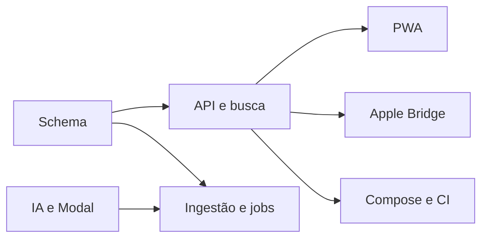

# Plano e checklist v1

- [ ] Fundação: schema, configuração, auth, migrations e storage privado.
- [ ] Ingestão incremental e idempotente, mídia, identidade e fixtures.
- [ ] Jobs duráveis, lease, heartbeat, retry, batches e SSE persistido.
- [ ] JoyTag, SigLIP 2, Modal, taxonomy, persistência e budgets.
- [ ] Busca estruturada, semântica, filtros, cursores e explicações.
- [ ] PWA completa com galeria virtual, viewer e páginas operacionais.
- [ ] Protocolo Apple seguro e Bridge Pyto com capabilities reais.
- [ ] Compose, CI, Codespaces, Cloudflare, Oracle, backup e restore.
- [ ] Lint, types, unitários, integração, build e E2E executados.
- [ ] Relatório de evidências/limitações e entrega no GitHub.

## Decisões e dependências

ADR-001: PostgreSQL como fonte de verdade para jobs e eventos; SKIP LOCKED.
ADR-002: mídia em proxy autenticado, sem cache de fotos no service worker.
ADR-003: Access JWT validado criptograficamente com allowlist e origem privada.
ADR-004: adapters externos nunca fabricam resultados; GPU desabilitada por padrão.
ADR-005: writes Apple exigem mapping inequívoco, capability verificada e aprovação.
ADR-006: deployment preparado, sem publicação ou gasto automático.

## Riscos

| Risco | Mitigação |
| --- | --- |
| API iCloud não oficial | execuções limitadas, auth terminal, falhas explícitas |
| Keyword APIs Beta | adapter isolado e validação no dispositivo |
| Custos GPU | opt-in, budgets estimados, controles do provedor |
| Biblioteca grande | índices, batches, cursores e virtualização |
| Perda de dados | constraints, backups, nenhuma exclusão original |

Credenciais e hardware externos não são simulados como operacionais.
