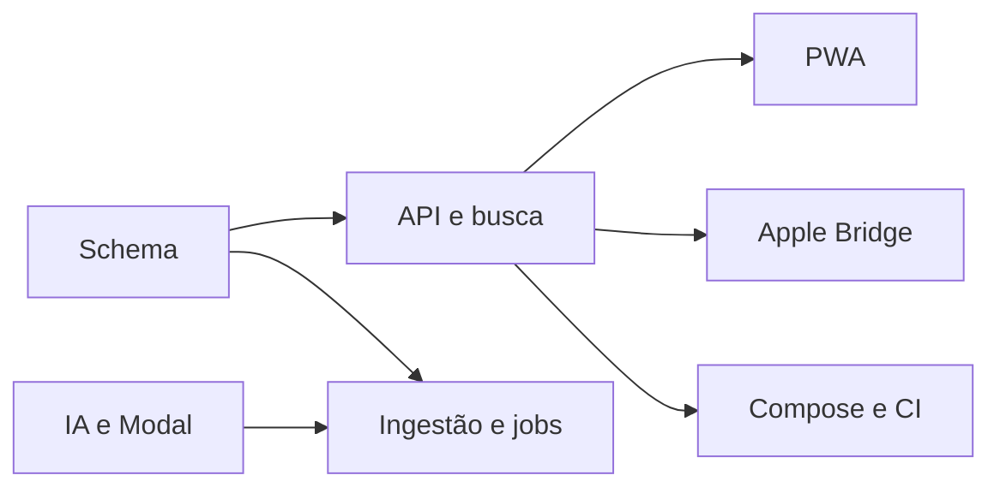

# Plano e checklist v1

- [x] Fundação implementada: schema, configuração, auth, migrations e storage privado.
- [x] Ingestão incremental/idempotente, mídia, identidade e fixtures implementadas.
- [x] Jobs duráveis, lease, heartbeat, retry, batches e SSE implementados.
- [x] Adaptadores reais JoyTag, SigLIP 2 e Modal, taxonomy, persistência e budgets.
- [x] Busca estruturada/vetorial, filtros, cursores e explicações implementados.
- [x] PWA com galeria virtual, viewer e páginas operacionais implementadas.
- [x] Protocolo Apple e Bridge Pyto implementados; validação iOS pendente.
- [x] Compose, CI, Codespaces, Cloudflare, Oracle, backup e restore implementados.
- [x] Lint, types, unitários, integração, build e E2E executados e aprovados.
- [ ] Relatório de evidências/limitações e entrega no GitHub.

Marcas acima indicam código implementado. Não representam aprovação de todas as
integrações ou da aplicação completa. A conclusão depende dos checks abaixo.

## Validação em andamento — 15/10/2026

Checkpoint remoto aprovado `eb6b6b1943c1f19dade4ec84b86fe211f090470b`:

- [x] Instalação Python e npm a partir de locks reais.
- [x] OpenAPI exportado e tipos TypeScript gerados.
- [x] Ruff, Mypy, ESLint e TypeScript passaram no CI.
- [x] Pytest: 182 unitários e 34 de integração passaram.
- [x] Frontend: 31 testes e build passaram.
- [x] MinIO oficial, bucket privado, migrations até 0004 e papel limitado testados.
- [x] Dump/restore real de 16 imagens sintéticas com fingerprints de todas as tabelas.
- [x] Imagem API AMD64 construída e imports nativos testados.
- [x] Auditorias Python/npm e scanner de segredos passaram.
- [x] Metadados medidos com 10k, 100k e 176k registros; HNSW com 10k vetores.
- [x] Capturas reais Chromium do catálogo sintético em viewport de iPhone.
- [x] E2E: 31 passaram, 1 desmarcado intencionalmente, sem falhas.
- [x] Pesos reais JoyTag/SigLIP 2 em CPU, vetores/consultas PT e persistência: run 38830862284.
- [ ] Build ARM64 e implantação Oracle/Cloudflare/Modal, dependentes de configuração.
- [ ] Login/2FA/importação iCloud reais, dependentes da conta do operador.
- [ ] Inferência Modal/GPU real, dependente de configuração e execução explícita.
- [ ] PhotoKit/Keychain/Service Auth no iPhone e keywords, dependentes de hardware/conta.

Evidência: [bootstrap 38830845571](https://github.com/rodkisten/photointel/actions/runs/38830845571).
`reports/validation.json` registra outcomes reais: todos os checks obrigatórios passaram.
Dados sintéticos não comprovam operação da biblioteca privada. O detalhamento e
os relatórios permanentes estão em [VALIDATION.md](VALIDATION.md).

## Decisões e dependências

ADR-001: PostgreSQL como fonte de verdade para jobs e eventos; SKIP LOCKED.
ADR-002: mídia em proxy autenticado, sem cache de fotos no service worker.
ADR-003: Access JWT validado criptograficamente com allowlist e origem privada.
ADR-004: adapters externos nunca fabricam resultados; GPU desabilitada por padrão.
ADR-005: writes Apple exigem mapping inequívoco, capability verificada e aprovação.
ADR-006: deployment preparado, sem publicação ou gasto automático.

## Riscos

| Risco | Mitigação |
| --- | --- |
| API iCloud não oficial | execuções limitadas, auth terminal, falhas explícitas |
| Keyword APIs Beta | adapter isolado e validação no dispositivo |
| Custos GPU | opt-in, budgets estimados, controles do provedor |
| Biblioteca grande | índices, batches, cursores e virtualização |
| Perda de dados | constraints, backups, nenhuma exclusão original |

Credenciais e hardware externos não são simulados como operacionais.
