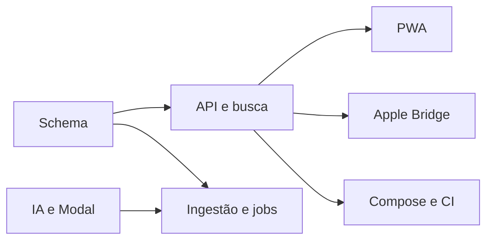

# Plano e checklist v1

- [x] Fundação implementada: schema, configuração, auth, migrations e storage privado.
- [x] Ingestão incremental/idempotente, mídia, identidade e fixtures implementadas.
- [x] Jobs duráveis, lease, heartbeat, retry, batches e SSE implementados.
- [x] Adaptadores reais JoyTag, SigLIP 2 e Modal, taxonomy, persistência e budgets.
- [x] Busca estruturada/vetorial, filtros, cursores e explicações implementados.
- [x] PWA com galeria virtual, viewer e páginas operacionais implementadas.
- [x] Protocolo Apple e Bridge Pyto implementados; validação iOS pendente.
- [x] Compose, CI, Codespaces, Cloudflare, Oracle, backup e restore implementados.
- [ ] Lint, types, unitários, integração, build e E2E executados.
- [ ] Relatório de evidências/limitações e entrega no GitHub.

Marcas acima indicam código implementado. Não representam aprovação de todas as
integrações ou da aplicação completa. A conclusão depende dos checks abaixo.

## Validação em andamento — 15/10/2026

Checkpoint remoto `edb2df8a22e3f216872992af656f6dd9c8be663c`:

- [x] Instalação Python com `uv.lock` e grupo `ingest` no GitHub Actions.
- [x] Instalação npm e atualização do lock para Vitest 5.0.4 no bootstrap.
- [x] OpenAPI exportado do FastAPI e tipos TypeScript gerados.
- [x] Mypy executado sem erros no backend, GPU e Bridge.
- [x] Pytest: 116 testes passaram, 16 desmarcados, sem GPU/contas externas.
- [x] Imagem da API construída e imports nativos testados no runner AMD64.
- [x] Auditorias de dependências do bootstrap e scanner de segredos passaram.
- [ ] Ruff em CI após correções locais (check local agora passa).
- [ ] Tipos, testes e build web após correções da galeria/cliente gerado.
- [ ] Migrations, integração e E2E: bloqueados nesta rodada pelo pull do MinIO;
      substituição por build do código oficial em implementação.
- [ ] Medições com PostgreSQL e validação de restauração representativa.
- [ ] Implantação real em Oracle/Cloudflare/Modal, dependente de configuração.
- [ ] Login/2FA/importação iCloud reais, dependentes da conta do operador.
- [ ] Inferência com pesos reais e GPU, dependente de execução explícita/custos.
- [ ] PhotoKit/Keychain no iPhone e keywords, dependentes do runtime e hardware.

Evidência: [bootstrap 38808843904](https://github.com/rodkisten/photointel/actions/runs/38808843904).
As condições reais estão em `reports/validation.json` do artifact, pois checks
independentes usam `continue-on-error` para coletar todas as falhas. O workflow
falha ao final se qualquer verificação obrigatória não passar.

## Decisões e dependências

ADR-001: PostgreSQL como fonte de verdade para jobs e eventos; SKIP LOCKED.
ADR-002: mídia em proxy autenticado, sem cache de fotos no service worker.
ADR-003: Access JWT validado criptograficamente com allowlist e origem privada.
ADR-004: adapters externos nunca fabricam resultados; GPU desabilitada por padrão.
ADR-005: writes Apple exigem mapping inequívoco, capability verificada e aprovação.
ADR-006: deployment preparado, sem publicação ou gasto automático.

## Riscos

| Risco | Mitigação |
| --- | --- |
| API iCloud não oficial | execuções limitadas, auth terminal, falhas explícitas |
| Keyword APIs Beta | adapter isolado e validação no dispositivo |
| Custos GPU | opt-in, budgets estimados, controles do provedor |
| Biblioteca grande | índices, batches, cursores e virtualização |
| Perda de dados | constraints, backups, nenhuma exclusão original |

Credenciais e hardware externos não são simulados como operacionais.
