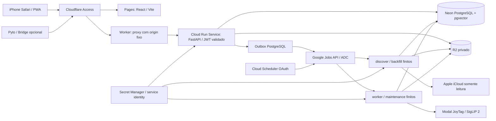

# Destino Cloud Run v1.1

Esta topologia amplia a aplicação existente. Compose continua desenvolvimento;
Oracle/VPS permanece fallback até validação real. A fronteira de estado durável
é PostgreSQL/R2, nunca o filesystem do container ou a vida de uma requisição.

## API e limites

`photointel-api` é stateless: min instances 0, cobrança por requisição, máximo
inicial 3, concorrência inicial 8, CPU 1 e RAM 1 GiB. São parâmetros operacionais,
não garantia de capacidade. Só inicia Uvicorn e respeita `$PORT`; não inicia
cron, worker, scheduler nem thread de ingestão após resposta HTTP. Health live
serve à startup/liveness; saúde de serviços externos é diagnóstico separado.

Em Neon transaction pooling, conexões locais usam NullPool e prepared statement
cache desabilitado. O teto de requisições/instâncias e tasks é parte do orçamento
de conexões. PostgreSQL sem pooler continua suportado com pool pequeno e overflow
zero. Migrations usam endpoint direto e serialização por advisory lock; jamais
rodam automaticamente em cada cold start.

## Trabalho finito

Jobs nomeados: `photointel-discover`, `photointel-backfill`,
`photointel-worker`, `photointel-maintenance`, `photointel-migrate`. A fila
PostgreSQL decide identidade, estado, prioridade, lease, fencing e retries.
As task replicas concorrem por aquisição atômica; não repartem um offset Apple
frágil. O encerramento ocorre pelo limite de trabalho/deadline ou SIGTERM.
O próximo Job continua do checkpoint persistido. Retries Google não são a fonte
de verdade e podem duplicar invocações sem duplicar resultados.

Scheduler tem apenas três rotinas (discover, worker e maintenance). Backfill é
manual, limitado e exige aprovação de expansão e gates. Por padrão todos os
agendamentos são deixados pausados. OAuth da service account Scheduler chama
`jobs:run`; OIDC contra a API Google não é o mecanismo utilizado.
A API pode solicitar apenas os quatro Jobs permitidos por nome fixo; não pode
executar migrations, injetar argumentos, invocar URLs arbitrárias ou fazer DDL.
O outbox é persistido na mesma transação da intenção de trabalho, antes da rede.
Uma falha ambígua de transporte pode gerar duas execuções, protegidas pela fila.

## Sessão iCloud

Autenticação inicial ocorre em terminal interativo Codespaces/Cloud Shell; não
no browser Photo Intelligence ou Job não interativo. O snapshot cifrado AES-GCM
fica no R2 privado; a chave está em Secret Manager. PostgreSQL guarda ponteiro,
revisão, lease e fencing para a sessão. Arquivos são reidratados com permissões
restritas em diretório efêmero e removidos ao final. Atualizações publicam
objeto imutável e compare-and-swap, impedindo sessão antiga de sobrescrever nova.
O filesystem local é cache de execução; não é checkpoint ou armazenamento de
cookies. Ausência/expiração exige reautenticação, não senha Apple em variável.

## Segurança e superfície pública

O origin Run usa rede pública para permitir o proxy Cloudflare sem misturar
Google IAM e Access de maneira incompatível. Isso não é uma rede privada.
A API valida criptograficamente cada JWT de requisição protegida, inclusive
acesso direto ao `run.app`; header com email não autentica ninguém. Bridge
exige identidade Access service-auth separada e credencial própria de device.
Buckets são privados e credenciais nunca chegam ao frontend. Proxy não confia
em headers forwarded arbitrários e não permite origin fornecido pelo usuário.

Runtime API/Jobs/migration/Scheduler/Build/deploy têm service accounts distintas.
Secrets são concedidos por referência e versão numérica, sem chave JSON de
service account. GitHub usa WIF, branch confiável, ambiente protegido e deploy
manual com autorização de cobrança. Migração é execução independente com backup
verificado ou confirmação explícita de banco novo vazio.

## Custo, portabilidade e evidência

Não são necessários VPC connector, NAT, IP estático, Kubernetes ou load balancer
adicionais nesta topologia. Removê-los não elimina custos de CPU/RAM, execução
Jobs, Scheduler, builds, registry, logs, Secret Manager e tráfego entre Google,
R2, Neon e Modal. Pooler e sleep do banco devem ser medidos em consultas reais.
Neon limitado possui catálogo explicitamente capado; biblioteca completa exige
medição de capacidade e perfil dimensionado, sem promessa de gratuidade.

`infra/gcp/manage.py` produz definições JSON compatíveis com Cloud Run v1 a
partir de configuração validada e usa comandos gcloud reproduzíveis. O modo
padrão é offline. Os testes comprovam estruturas/limites e construção dos
comandos; validação de contas, deploy e faturamento depende de autorização real.
[Guia operacional](../../CLOUD_RUN_SETUP.md) descreve a sequência pelo iPhone.
