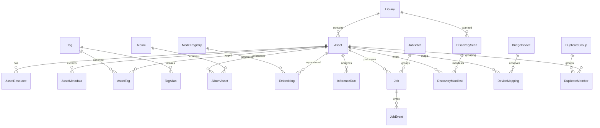
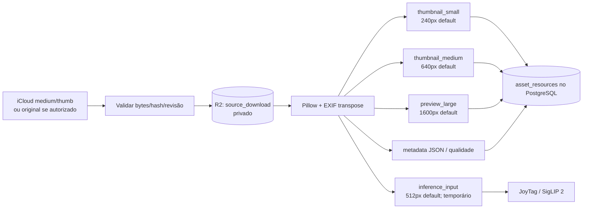
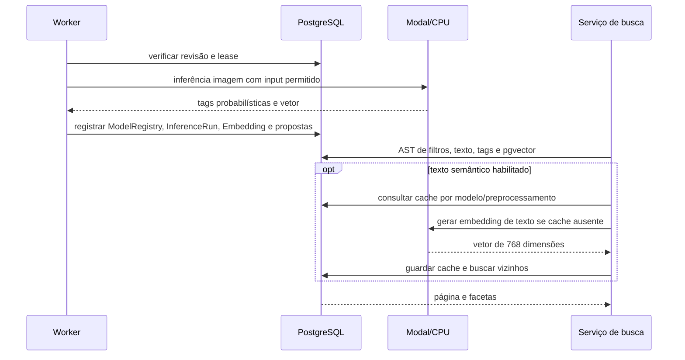

# Modelo de dados, storage, buscas, modelos e persistência

**Fonte:** `apps/api/src/photointel/models.py`, `infra/migrations/versions/0001..0007`, `services/media.py`, `services/inference.py`, `services/search.py`, `gpu/*`. Base `22c01bc`.

## 1. Catálogo relacional

O diagrama é **lógico**, não um desenho de todas as constraints físicas. Confirme nomes, nullable, cascades e índices em `models.py` e nas sete migrações Alembic. Outras tabelas independentes importantes: `Settings`, `SavedSearch`, `DurableLease`, `ObjectIntent`, `SessionState`, `QueryEmbeddingCache`, `VerificationGate`, `DispatchOutbox`, `SyncOperation` e `AuditEvent`.

| Entidade | Semântica |
|---|---|
| `Asset` | UUID interno, identidade de fonte, estado, revisão de conteúdo/representação |
| `AssetResource` | ligação controlada ao objeto R2, variante, hash e metadados técnicos |
| `DiscoveryScan/Manifest` | progresso de enumeração, checkpoints e snapshots cifrados |
| `Job/JobBatch/JobEvent` | execução, eventos, prioridades, retries, pausa, cancelamento e progresso |
| `ObjectIntent` | registro de upload antes da confirmação relacional, para reconciliação |
| `InferenceRun/Embedding/ModelRegistry` | proveniência de modelo, embeddings, revisões e execuções |
| `AssetTag/Tag` | proposta, revisão manual, recusa e categorização |
| `SessionState` | ponteiro e versão de snapshot Apple, sem cookie em plaintext no banco |
| `DispatchOutbox` | despacho Google Jobs API tentável e deduplicado |
| `QueryEmbeddingCache` | embedding de texto com TTL, versão e lease |

## 2. PostgreSQL e Neon

Em produção, `database_pool_mode=transaction` pode usar endpoint Neon pooled com `NullPool` e configurações compatíveis; migração e backup usam endpoint **direto**. `DATABASE_REQUIRE_TLS` protege a conexão e exige validação de certificado/host conforme ambiente. O banco é a fonte de verdade para fila, status, autorização, idempotência, controles e auditoria. Nenhum job depende de ficar com um arquivo em `/tmp` após reinício.

O modo `database_profile=limited` aplica `catalog_asset_limit` com ledger transacional na admissão. Modo `full` demanda dimensionamento medido; liberar a flag não cria capacidade. Em biblioteca grande o custo vem de 768 dimensões por embedding, índices HNSW, raw predictions, tags, snapshots, jobs e logs, não apenas do número de fotos.

## 3. Objetos e derivados

`media.py` aplica limites de imagem, impede decompression bombs, remove metadados sensíveis dos bytes derivados e calcula brilho, contraste, nitidez por variância de Laplaciano e score **heurístico**. O encoder grava WebP quando disponível e fallback JPEG, com AVIF adicional opcional. Recurso e dimensão do cliente devem respeitar as variantes realmente persistidas. Não colocar bytes de mídia ou URLs assinadas em log nem em caches públicos.

A API serve mídia por `/v1/assets/{id}/media/{variant}`, autorização individual e streaming privado com headers condicionais/ranges, se o recurso existir. Um `404`/`422` não deve produzir imagem falsa; auditar stage e object intent para reconstrução.

## 4. Inferência

`gpu/modal_app.py` declara aplicativo Modal `photo-intelligence-v1`, runtime Python 3.12, GPU T4, escala a zero, no máximo um container, máximo uma entrada concorrente, volume de cache e Secret Modal `photo-intelligence-inference`. O serviço HTTP interno é `gpu/service.py`. Alterar `gpu_enabled`, backend e segredos é necessário; o manifesto do Modal **não** prova deploy concluído ou execução remunerada.

**JoyTag** oferece probabilidades/propostas de tags; **SigLIP 2** produz vetores imagem/texto compatíveis com revisão pinada. `Settings` fixa 768D, IDs/revisões e `query_preprocessing_revision`. Busca por texto semântico chama embedding textual; cache guarda referência de modelo/preprocessamento e validade. O backend pode usar `modal`, `cpu` ou `test` no contrato; modo `test` é proibido como substituto silencioso em produção.

Reprocessar modelo/revisão não deve sobrescrever tags manualmente aceitas/rejeitadas. Duplicidade por pHash é outra análise e não prova identidade perfeita. Vetores são aproximações, não classificação determinística nem reconhecimento de pessoas.

## 5. Migrações e contratos

Os arquivos `0001_catalog.py` a `0007_model_preprocessing_namespace.py` são a história do schema. Produção nunca executa migração automaticamente em cada startup da API. A migração roda isolada e serializada, usando URL direta/credenciais próprias e verificação de backup quando necessária. `packages/contracts/openapi.json` e `apps/web/src/api/schema.d.ts` devem corresponder à revisão realmente implantada.

Referências: [DATABASE](../../DATABASE.md), [NEON](../../NEON_SETUP.md), [Modelos](../../MODAL_SETUP.md), [Capacidade](../../CAPACITY_REPORT.md) e [Pipeline](INGESTION_AND_RECOVERY.md).
