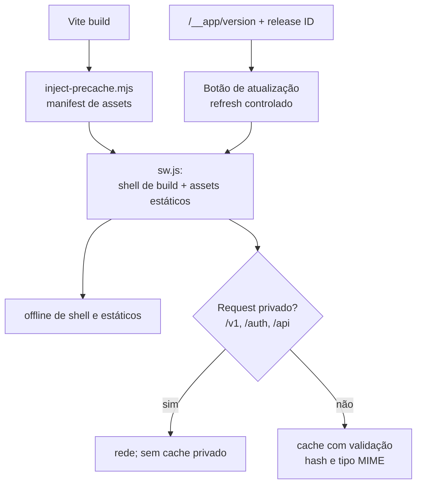
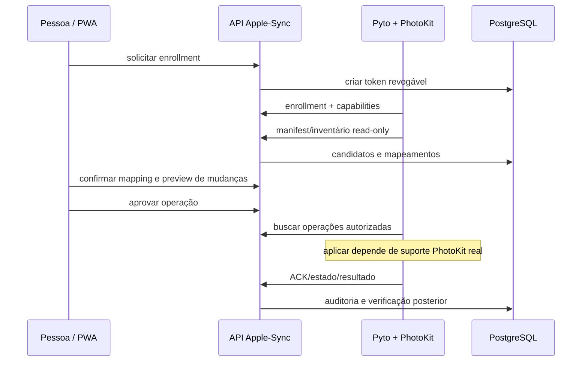

# Frontends, PWA, UX, notificações e Apple Bridge

**Fonte:** `apps/web`, `apps/manage`, `bridges/pyto`, `routers/bridge.py`. Auditoria em `22c01bc`.

## PhotoIntel Web

`apps/web/src/App.tsx` monta a SPA usando **React Router 7**. Páginas verificadas:

| Caminho | Módulo / responsabilidade |
|---|---|
| `/` | `pages/overview.tsx`: visão geral e estado |
| `/library` | `pages/library.tsx` e `components/gallery.tsx`: lista, mídia e viewer |
| `/search` | `pages/search.tsx`: filtros, busca textual e semântica |
| `/tags` | `pages/tags.tsx`: catálogo/taxonomia de keywords |
| `/albums` | `pages/albums.tsx`: agrupamento |
| `/duplicates` | `pages/duplicates.tsx`: duplicatas heurísticas |
| `/jobs` | `pages/jobs.tsx`: jobs, batch, controle e auditoria |
| `/icloud` | `pages/icloud.tsx`: ingestão e sessão |
| `/bridge` | `pages/bridge.tsx`: sincronização Apple opcional |
| `/settings` | `pages/settings.tsx`: preferências |
| `/setup` | `pages/setup.tsx`: preparação, validação e capacidades |

`components/jobs-drawer.tsx` implementa painel persistente de trabalhos na shell, e `components/preview-audit.tsx` verifica imagens ausentes. `components/viewer.tsx` realiza visualização; `components/incident-inspector.tsx` abre investigações. `src/api/client.ts` e `src/api/generated-client.ts` encapsulam acesso tipado, com schema de `packages/contracts/openapi.json`. Estado remoto usa TanStack Query; estado local usa Zustand. A estrutura é Vite, React 19, TypeScript, Tailwind 4, Radix e Lucide.

## Manage Web + Worker

O Manage não compartilha o mesmo roteador do PhotoIntel: `apps/manage/src/router.tsx` usa **TanStack Router 1.170.46** com parâmetros de busca validados por Zod. `src/worker.ts` é BFF administrativo no edge com autenticação de Access.

| Rota | Objetivo |
|---|---|
| `/` | visão geral de integrações |
| `/deploys` / `/deploys/$runId` | workflows, execução, etapas e logs |
| `/logs` | pesquisa GCP/Cloudflare/Sentry por escopo e ID |
| `/environment` | editor de `GCP_CONFIG_ENV` / configuração e reconciliação |
| `/secrets` | Secret Manager, criação de versões e histórico |
| `/icloud` | teste/recuperação de sessão |
| `/system` | informações, serviços e conexões |

`src/pages/ConfigEditor.tsx`, `components/codemirror-env-editor.tsx`, `components/dotenv-fields.tsx` oferecem JSON/.env e edição orientada a campos; `features/secrets/*` separa lista, versão e formulário. `components/json-view.tsx`, `components/scroll-area.tsx` tratam logs. `src/api.ts` integra provedores apenas no Worker. O frontend não deve receber token GitHub/GCP/Cloudflare.

## PWA e atualizações

O `apps/web/public/sw.js` tenta fazer precache do shell/arquivos de release e isola alterações por versão, evitando servir HTML como JS após publicação. Nunca prometer que “tudo é cacheado para sempre”: API privada, fotos, sessão Access e notificações não entram no cache público. `apps/web/scripts/generate-brand.mjs` gera iconografia; `manifest.webmanifest`, `PWA_BRANDING.md` e `DESIGN_SYSTEM.md` documentam identidade. O Worker entrega `index.html` e `sw.js` com `no-store`, enquanto bundles com hash têm política distinta.

## Push

`apps/web/public/fcm.js` faz registro do Firebase no navegador e sincroniza a instalação via `POST /v1/push/registrations`. `sw.js` carrega SDK Firebase no service worker, trata push em segundo plano e ao clicar abre/reutiliza janela na **mesma origem**. Suporte de push no iOS depende de PWA instalada, permissões, HTTPS e runtime do Safari; testes no desktop não comprovam recebimento no iPhone.

## Apple Bridge

`bridges/pyto/bridge.py` roda no iPhone/Pyto quando capacidades reais permitem. `routers/bridge.py` distingue enrollment, capability, inventário, mapeamento, proposta, aprovação, operação e acknowledgment. O adaptador atual tem limitações: inventário read-only não comprova escritor de keywords PhotoKit; Cloud Run não tem PhotoKit. Jamais tratar local identifier, iCloud ID e filename como identidade equivalente. A operação de escrita precisa ser suportada, autorizada e verificada no dispositivo e por leitura posterior.

## Testes/limites de UX

`apps/web/src/test` e `apps/web/tests/e2e` cobrem estados de interface, segurança de API, galerias, previews e navegação móvel. `apps/manage/src/*.test.ts` verifica rotas, configurações, segredos, logs e autenticação iCloud. WebKit em Linux ou screenshot de viewport móvel não equivalem a validação física no iPhone, especialmente teclado, safe areas, pinch/swipe, Access e background FCM.

Referências: [Design system](../../apps/web/DESIGN_SYSTEM.md), [Branding](../../apps/web/PWA_BRANDING.md), [Pyto](../../PYTO_BRIDGE.md), [iPhone acceptance](../operations/iphone-acceptance.md).
