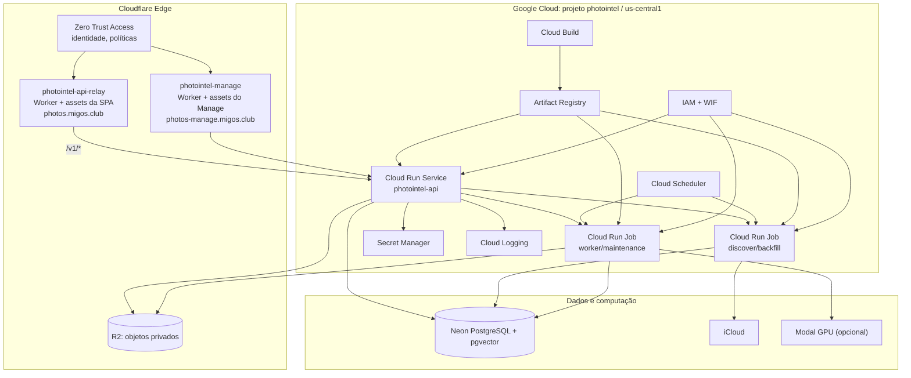
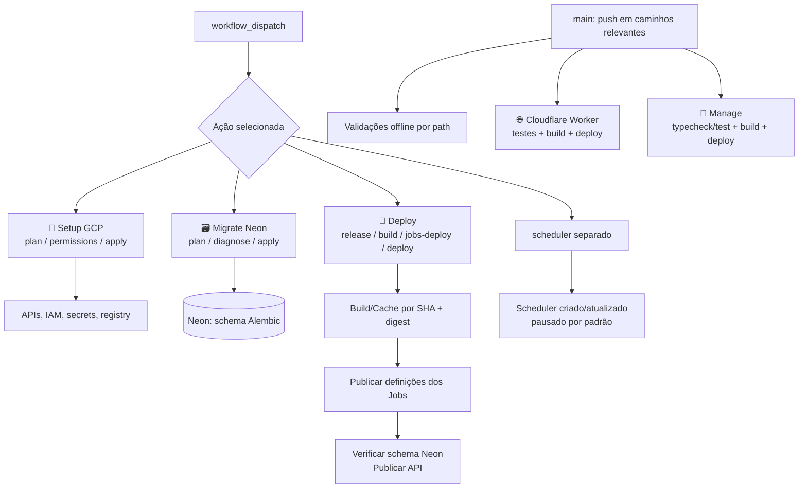

# Infraestrutura Cloudflare, Google Cloud, Neon, R2 e Modal

**Código auditado:** `22c01bc`, 04/11/2026. **Importante:** manifests e workflows descrevem implantação pretendida; para constatar recursos e tráfego reais, consulte GCP, Cloudflare e Manage.

## 1. Três camadas operacionais

## 2. Cloudflare: o Worker unificado

O `deploy-worker.yml` instala e valida a SPA em `apps/web`, roda testes do Worker e usa `infra/scripts/prepare_workflow_env.py` para descobrir **a URL real** do `photointel-api` no Cloud Run e gerar a configuração final de deploy. A origem upstream é fixa e deve ser `https://*.run.app`, sem path, query, credenciais ou porta arbitrária. O código `worker.mjs`:

- Serve `/`, assets estáticos e fallback SPA por binding `ASSETS`.
- Encaminha somente `/v1/*`, com cabeçalhos permitidos, políticas privadas, suporte a Range e correlation ID.
- Implementa `/auth/login`, `/__app/version` e `/__diagnostics/client-errors`; evita incluir corpo, JWT, URL privada ou stack nos logs sanitizados.
- Envia `index.html`, service worker e manifest com headers `no-store`. Assets com hash são tratados separadamente.
- Em previews `PHOTOINTEL_PREVIEW=true`, entrega assets **sem** acesso à API ou sign-in Apple.

`infra/cloudflare/cloud-run-proxy/wrangler.toml` é **modelo de metadados/desenvolvimento**, não a configuração completa publicada. `apps/web/wrangler.preview.jsonc` configura previews visuais. O antigo guia de Pages deve ser interpretado à luz do Worker vigente.

O Manage é Worker separado: `apps/manage/wrangler.jsonc` define domínio próprio, assets e observabilidade; `apps/manage/src/worker.ts` protege tanto SPA quanto APIs após JWT. Integração de log/segredo usa as APIs GitHub, Cloudflare, Google e Sentry, sem distribuir tokens no navegador.

## 3. GCP: runtime e contas de serviço

O projeto de referência é `photointel` na região `us-central1`, parametrizados no `GCP_CONFIG_ENV`. O bootstrap `infra/gcp/bootstrap.sh` é idempotente, com modos `plan`, `permissions` e `apply`. Configura os serviços relevantes de Run, Scheduler, Secret Manager, Artifact Registry, Cloud Build, Logging, IAM/IAM Credentials e STS; o bloco de FCM habilita `fcm.googleapis.com` e concede `roles/firebasecloudmessaging.admin` às identidades de API e Jobs.

A separação de privilégios é parte da arquitetura:
- `photointel-bootstrap`: provisionamento administrativo/WIF apropriado.
- `photointel-deployer`: builds e deploy normal, sem permissões administrativas permanentes.
- `photointel-builder`: build de imagens.
- `photointel-api`: runtime HTTP/saída autenticada.
- `photointel-jobs`: runtime de processamento e envio de notificações.
- `photointel-migrate`: migração com credencial de banco própria.
- `photointel-manage`: impersonação administrativa restrita para leitura de logs e versões/criação de secret; nunca usar no frontend.

A lista exata de concessões, políticas condicionais e recursos deve ser inspecionada em `infra/gcp/bootstrap.sh` e `bootstrap_manage_wif.sh`, **não** copiada de uma tabela estática como permissão já aplicada. FCM pertence ao projeto `photointel`, sem projeto Firebase alternativo assumido.

## 4. Configuração e segredo

O workflow prepara `vars.GCP_CONFIG_ENV` no Environment `production` pela action `.github/actions/gcp-config/action.yml`. Esse documento contém opções não secretas e **referências nome/versão** de Secret Manager; `infra/gcp/config.example.json` documenta o schema de bootstrap. Dados sensíveis vivem como versões de secrets no GCP, ou em variáveis de runtime explicitamente provisionadas para uma integração. `prepare_workflow_env.py` resolve credenciais efêmeras por WIF sem imprimi-las. Editar a configuração no Manage não substitui auditoria de IAM, re-deploy/rollout ou teste da versão carregada.

## 5. Pipeline de publicação

### Matriz de workflows conferidos

| Workflow | Disparo / efeito principal |
|---|---|
| `gcp-bootstrap.yml` | pushes/PR validam offline; manual `plan`/`permissions`/`apply`; permissões FCM |
| `gcp-migrate.yml` | push valida; manual aplica Alembic sob condições de banco/backup |
| `gcp-deploy.yml` | push verifica configuração offline; manual release ou fases; cron `23 * * * *` como watchdog de manutenção |
| `deploy-worker.yml` | push main e manual publicam Worker unificado; PR somente valida |
| `manage-deploy.yml` | push main ou manual: plan/apply do Manage |
| `backend-smoke.yml` | PR/push: Python, Postgres e smoke de previews |
| `ci.yml` | testes de lock, lint, tipos, integração, frontend, containers/E2E |
| `gcp-health.yml` | valida conexão API + Neon + R2; diagnóstico sanitizado |
| `icloud-setup.yml` | pré-teste de chave/PG/R2 sem login real Apple |
| `frontend-format-fix.yml` / `manage-format.yml` | formatação de UI conforme escopo |

A pasta `.github/workflows` contém **mais** workflows (preview, release manifest, Cloudflare setup, retention, terminal, zip, notificação etc.). Nunca citar “13 workflows” como quantidade atual; o conjunto muda com a branch.

### Regras de release

O `infra/gcp/release.sh` mantém `migrate` separado de `release` e substitui o checkbox antigo de banco por **verificação read-only de revisão Alembic**. O release compõe build/cache, publicação de Jobs e deploy da API; **não dispara** ingestão ilimitada, migration automática nem inferência GPU. O Scheduler é configurado pausado, salvo reativação operacional explícita. Imagens ligadas a SHA/digest e registros de versão reduzem mistura de frontend/API incompatíveis.

Os caminhos de bootstrap e gestão podem exigir autorização de billing para `apply`; o fato de uma tela não mostrar um checkbox antigo não elimina proteções no script ou responsabilidade de revisar custos.

## 6. Scheduler versus watchdog

`infra/gcp/config.example.json` propõe cron de discovery `0 * * * *`, worker `*/10 * * * *` e maintenance `17 */6 * * *`, em UTC e pausados por default. São **valores de exemplo**. O cron de GitHub `23 * * * *` no `gcp-deploy.yml` é rede de segurança para iniciar manutenção finita quando necessário; ele não monitora continuamente um processo em background.

## 7. Diagnóstico de deploy

Ordem mínima: verificar SHA/digest e últimas execuções de Actions → revisão Cloud Run `photointel-api` → `/health/live` e `/health/ready` → alcance JWT real → conexão TLS do Neon e bucket privado R2 → Jobs/Scheduler → sessão Apple → GPU opcional. Não publicar secrets, outputs de `gcloud secrets versions access`, token Access ou conteúdo de imagens em tickets/logs.

Leia [Segurança](SECURITY_AND_SECRETS.md), [Observabilidade](OBSERVABILITY_AND_OPERATIONS.md), [Cloud Run do zero](../deployment/CLOUD_RUN_FROM_ZERO.md) e [Ações GCP](../operations/GITHUB_ACTIONS.md).
