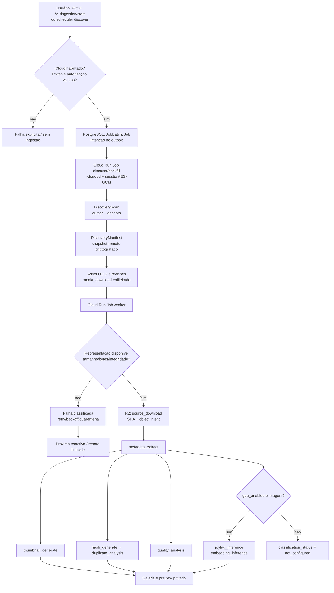
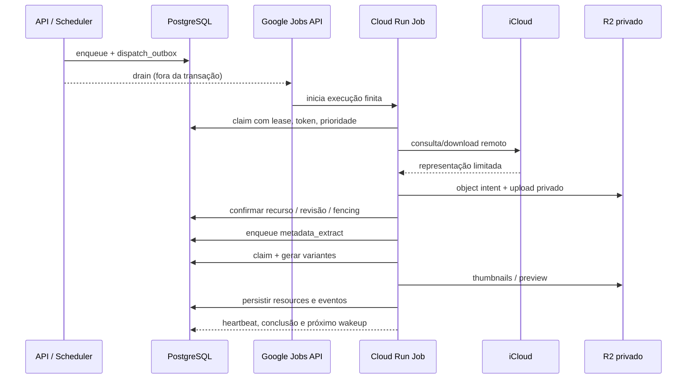
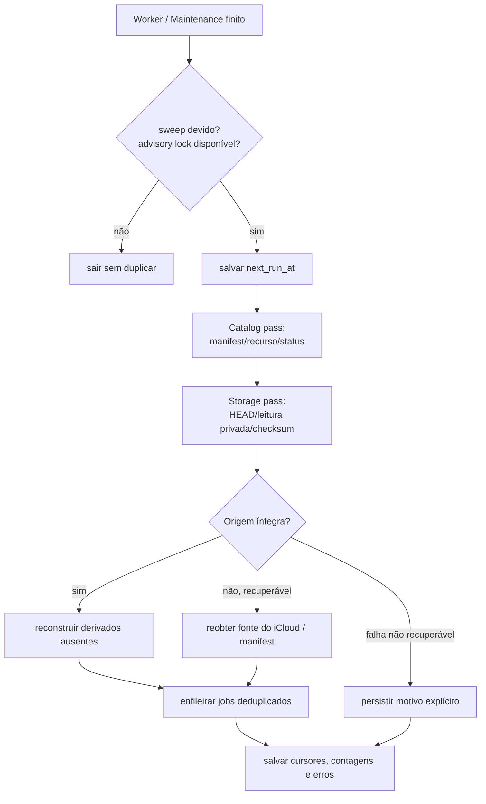

# Ingestão iCloud, fila, mídia e recuperação automática

**Base:** `discovery.py`, `ingestion.py`, `worker.py`, `task_runner.py`, `preview_repair.py`, `media.py` no commit `22c01bc`.

## Fluxo de alto nível

A divisão não é “descobrir tudo, depois gerar todos os thumbnails”: cada asset possui jobs independentes; download bem-sucedido gera metadata_extract que gera os demais estágios. Lotes são unidades de acompanhamento/controle, não transações atômicas gigantes. Erro em uma mídia não deve reverter o progresso de outras.

## Descoberta: cursor não é identidade

A implementação de `icloudpd` itera por offset/startRank, não por cursor CloudKit estável. `discovery.py` armazena scan, modo (incremental/backfill/reconciliation), checkpoints e últimos IDs âncora. Se os anchors mudarem, a descoberta reinicia a enumeração e deduplica contra manifests/IDs persistidos. Não infira exclusão definitiva a partir de uma única enumeração incompleta.

`DiscoveryManifest` armazena snapshot necessário para recriar o objeto remoto, incluindo URLs assinadas sob AES-256-GCM com AAD de biblioteca/asset/revisão; tokens e URL não devem aparecer nos logs. `source_identifier` e o UUID interno permanecem distintos. Live Photos e recursos relacionados precisam de vínculo verificado; vídeos v1 não entram na análise de frames.

## Autorização e orçamento

Em `config.py` os defaults incluem `initial_import_limit=100`, `maximum_authorized_import_limit=1000`, `hard_import_limit=10000`, `max_download_bytes=20 MiB`, `max_run_download_bytes=2000 MiB`, `ingestion_maximum_attempts=5`. O perfil/capacidade de catálogo também restringe entrada. Esses são **defaults do código**, não prova de que overrides em banco ou produção coincidam.

O código registra autorização e `requested_batch_limit` no job. Expansão não pode ser reduzida silenciosamente e backfill contínuo requer autorização persistida. O consumo é reservado e reconciliado no banco; orçamento de aplicação não equivale a limite de cobrança GCP ou Apple.

## Sequência dos estágios do worker

- `metadata_extract`: decode com EXIF transpose, remoção de EXIF do derivado, metadados permitidos, qualidade heurística e geração de variantes.
- `thumbnail_generate`: verifica/estabiliza recursos de thumbnail; `hash_generate` conduz à análise de duplicatas.
- `joytag_inference` e `embedding_inference`: opcionais, dependem de backend/capacidade, persistem proveniência e não sobreescrevem intervenção manual.
- `apple_sync`: registra aguardando dispositivo. Cloud Run **não** tem PhotoKit e não pode escrever keywords sozinho.

Os arquivos derivados têm nomes de recurso estáveis (small, medium, large, input inferência), com WebP e variantes AVIF opcionais conforme codec, e fallback JPEG. `srcset` no browser exige que as variantes estejam realmente disponíveis; um placeholder não significa recuperação da fonte.

## Jobs finitos e garantias

`task_runner.py` aceita `discover`, `backfill`, `worker`, `maintenance`, `migrate`; `--max-jobs` e `--deadline-seconds` limitam cada invocação. O runner respeita SIGTERM; claims interrompidos são retomáveis. `services/jobs.py` implementa idempotência, status e retries; `leases.py`/fencing impedem commits tardios de workers vencidos. `outbox.py` separa enqueue durável de chamadas externas; `cloud_dispatch.py` usa ADC para despachar Cloud Run Jobs.

O modo `discover` somente reivindica `icloud_discovery` incremental; `backfill` reivindica os trabalhos autorizados; `worker` trata demais jobs; `maintenance` recupera claims, limpa temporários e reconcilia intents/órfãos. Wakeups complementares evitam que download recém-descoberto dependa exclusivamente de outro tick do Scheduler.

## Autorreparo de previews

`run_automatic_preview_repair()` é acionado pelo runner `worker` e `maintenance`:

1. Respeita `auto_preview_repair_enabled` e `jobs_paused`.
2. Adquire `pg_try_advisory_xact_lock` e atualiza `next_run_at` **antes** da rede.
3. Percorre catálogo por cursor para assets sem derivados e falhas recuperáveis, observando `ingestion_paused`.
4. Faz uma passagem independente no R2, **lendo/verificando** recursos esperados; objeto ausente/corrompido não deve ser tratado igual a erro transitório do storage.
5. Enfileira trabalhos de recuperação limitados e persiste `catalog_cursor`, `storage_cursor`, `last_result`.

Defaults: intervalo de 60 min, lote de 40 para reparo, 15 verificações no R2, até 3 tentativas por semana. O workflow `gcp-deploy.yml` possui watchdog horário (minuto 23) para despertar manutenção quando o Scheduler não estiver operando; não equivale a processo continuamente ativo.

**Limites honestos:** uma fonte removida tanto do R2 quanto do iCloud ou sem manifesto/sessão válida pode ser irrecuperável. O reparador não inventa pixels nem restaura originais indisponíveis; login Apple, orçamento e capacidade de catálogo podem bloquear a fila. Para troubleshooting use [AUTO_PREVIEW_RECOVERY](../operations/AUTO_PREVIEW_RECOVERY.md) e [Manage iCloud](../operations/MANAGE_ICLOUD_PREVIEWS.md).

## Retentativas e inspeção

A UI dispõe de auditoria `GET /v1/jobs/previews/audit`, status de automação `GET /v1/jobs/previews/automation`, reparo individual `POST /v1/jobs/assets/{id}/preview/repair` e lote `POST /v1/jobs/previews/repair-batch`. Há endpoints de pausa, retomada e cancelamento de jobs/batches. O erro retornado deve manter `correlation_id`; confira logs do Cloud Run no Manage e eventos no PostgreSQL para localizar a etapa falha.

**Teste essencial:** fotos antigas com `source_download` perdido em R2; corruptos de mesmo tamanho; quota esgotada; sessão Apple expirada; concorrência entre dois runners; reinício após upload antes do commit; múltiplos assets parcialmente processados. Testes de integração não substituem uma execução real de iCloud com conta autorizada.
