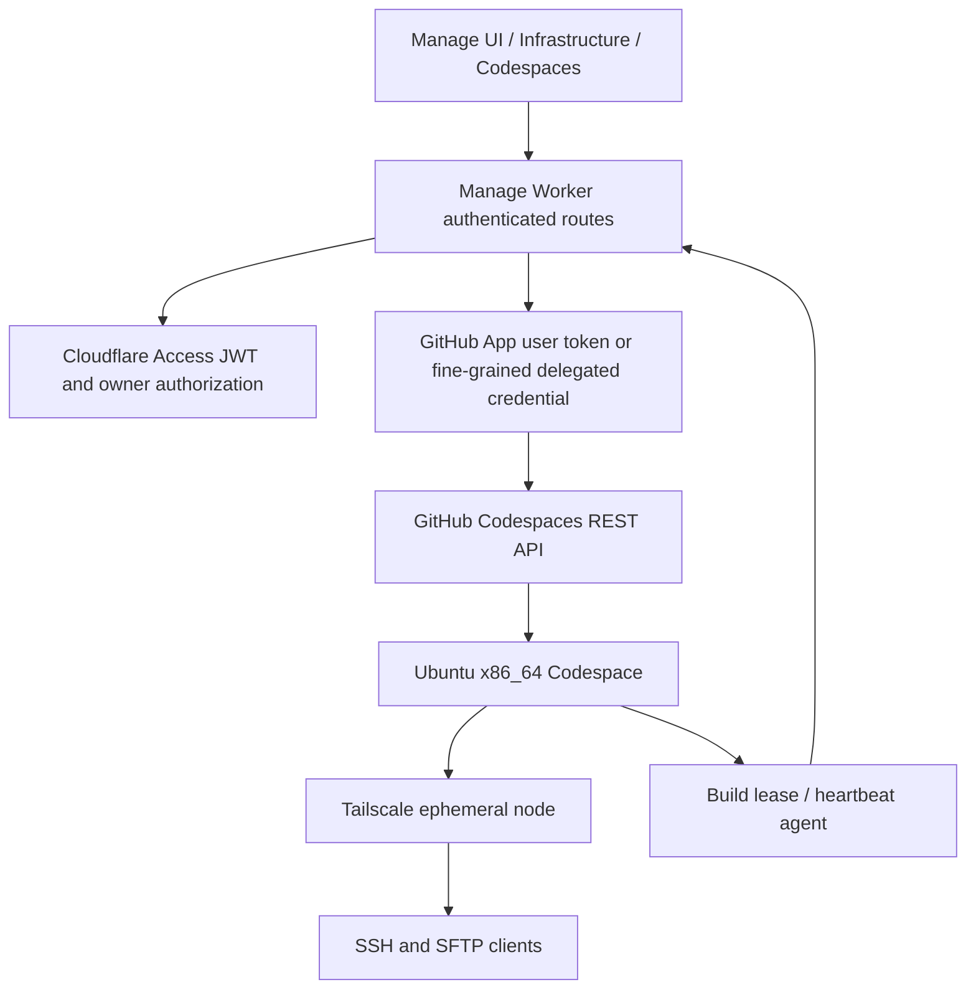

# 🖥️ Manage Codespaces · Architecture and implementation plan

Status: **Phase 1: architecture contract**. This document is the implementation baseline, not a claim that controls are deployed.

## Goal

Manage controls GitHub Codespaces for an authenticated owner: list, inspect, create, start, stop, and eventually delete. Default idle timeout **15 minutes**, build protection enabled, Tailscale enabled, SFTP enabled. Prefer GitHub's native lifecycle controls and billing model; do not confuse a stopped Codespace with deleted storage.

## Architecture



### Trust boundaries

1. **Browser never receives GitHub tokens, Tailscale auth keys or SSH private keys.** Manage Worker checks existing Cloudflare Access auth and a narrow owner allowlist before forwarding any request.
2. Credentials are stored in existing secret infrastructure; use a GitHub token with Codespaces permissions only as needed, never a broad repo PAT if a narrower credential is available. Audit mutations, redact secrets, use request IDs.
3. No public SSH/FTP port. Tailscale connects authorized devices to an SSH server inside the Codespace. SFTP is the SSH subsystem; plain FTP is out of scope.
4. GitHub Codespaces is not an always-on server: stopped Codespaces have no Tailscale endpoint, no SSH, and no background jobs.
5. Treat the Manage API as a control plane only; do not tunnel raw SSH or expose a browser terminal through the Cloudflare Worker in phase 1.

## Phase 1: GitHub control plane (first implementation block)

- [ ] Inspect the current Manage Worker routing/auth, API client, sidebar and query-cache conventions.
- [ ] Add typed server-side GitHub Codespaces adapter: list/get/create/start/stop; normalize GitHub states and API errors.
- [ ] Add authenticated read-only `GET /api/infrastructure/codespaces` and `GET /api/infrastructure/codespaces/:name`; protect mutation routes with explicit confirmation, owner authorization and audit trail.
- [ ] Add `POST /:name/start`, `POST /:name/stop`; creation should require explicit repository, machine type, branch and timeout.
- [ ] Add mobile-first Manage screen with real status, pending/failed operations and refresh. No fake controls or fabricated billing estimates.
- [ ] Test unauthorized access, token redaction, rate limits, state transitions and idempotent retries.
- [ ] Document secret names, API permissions, installation and rollback; update playground.

### API contract (proposed)

```ts
type CodespaceState = 'available' | 'starting' | 'stopping' | 'stopped' | 'failed' | 'unknown';
type Codespace = {
  name: string;
  repository: string;
  branch: string;
  state: CodespaceState;
  machine?: { name: string; cpus: number; memoryGb: number };
  idleTimeoutMinutes: number | null;
  lastUsedAt: string | null;
  webUrl?: string;
};
type CodespacesList = { items: Codespace[]; nextCursor?: string };
```

Backend must derive the user from verified auth, not an arbitrary user ID in the request. Mutations should return accepted/current state and poll for convergence rather than claiming instant success.

## Phase 2: devcontainer and multi-repository setup

- [ ] Reuse the existing `codespaces` repository as the primary workspace and document permissions for additional private repositories.
- [ ] Ubuntu x86_64 image with Node/pnpm, Go, Python/uv, Docker, gcloud, Wrangler, Git and Zsh; pin major versions and make bootstrap idempotent.
- [ ] Use a supported Tailscale Codespaces integration and a short-lived, scoped auth key from Codespaces secrets. Avoid persisting keys in repo, image or logs.
- [ ] Install OpenSSH server + SFTP subsystem with Tailscale ACLs; confirm Codespaces container privileges and startup behavior before promising direct SSH.
- [ ] Avoid automatically cloning all repositories on every boot; use a manifest and lazy clone, with explicit access permissions.

## Phase 3: build-aware idle policy

- [ ] Configure GitHub native idle timeout to **15 minutes** where supported by the creation API/account settings.
- [ ] Build lease agent tracks explicit jobs with heartbeats and expiration; no assumption that CPU usage or detached shell prevents native timeout.
- [ ] Verify GitHub timeout semantics experimentally. If native timeout can stop active builds, implement a supported keepalive/runner design or move long builds to GitHub Actions; never depend on synthetic activity to bypass platform limits.
- [ ] Surface build lease and auto-stop state in Manage; include manual stop override with confirmation.
- [ ] Never destroy a Codespace or discard unsynced work as an idle cleanup action.

## Phase 4: costs and observability

- [ ] Read GitHub billing/usage where permissions and endpoints allow, distinguish estimates from billed usage.
- [ ] Show compute hours and persistent storage independently; warn before quotas are exhausted.
- [ ] Log operation ID, GitHub request ID, duration, error class, and state convergence; redact sensitive fields.
- [ ] Add workflow orchestrator nodes for start, await-ready, build, await-complete, stop, with cleanup on failure.

## Acceptance criteria

- Authorized owner can see actual Codespaces and start/stop one from iPhone.
- Unauthorized user cannot list or mutate resources.
- No secret appears in browser payloads, logs or GitHub commits.
- A running build is never silently reported as safe to stop.
- Tailscale and SFTP remain private and are clearly shown as unavailable when the Codespace is stopped.
- Documentation and playground updated alongside each implemented capability.

## Deployment notes

No deployment in this architecture-only phase. No new secret is created or changed. Before phase 1 coding, inspect existing Manage authentication and API conventions to avoid bypassing security or introducing duplicate infrastructure.
