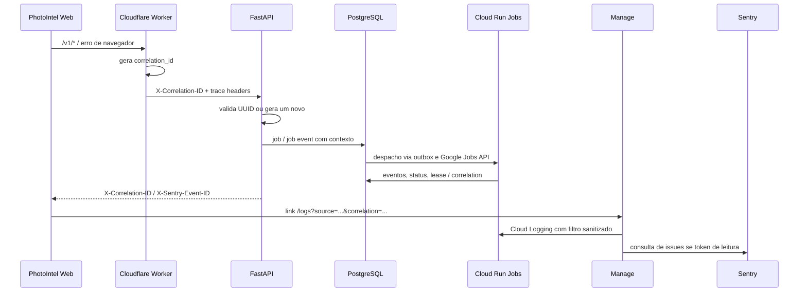
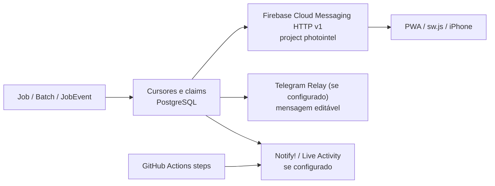

# Observabilidade, logs, jobs, custos e notificações

**Base do código:** `22c01bc`, 04/11/2026. **Não confundir** logging implementado com indexação e correlação operacional já comprovadas em todos os provedores.

## 1. IDs e percurso de incidente

`main.py` aceita apenas UUID canônico no `X-Correlation-ID`, emite novo identificador quando inválido, define contexto das operações e responde com `X-Correlation-ID`. Quando existe evento de Sentry, retorna também `X-Sentry-Event-ID`. `worker.mjs` gera identificador próprio nas falhas do edge e tem endpoint mínimo `/__diagnostics/client-errors` para erro JS sanitizado. `worker.py`, `task_runner.py` e `logging.py` usam eventos estruturados.

**Cuidado:** correlation ID compartilhado não garante que todos os provedores tenham o mesmo registro ou timestamp. GitHub workflow run ID, Cloud Run execution, Job UUID, Sentry event ID e Cloudflare Ray ID são identificadores diferentes que precisam de ponte explícita.

## 2. Onde procurar

| Indício | Fonte preferencial | Caminho de código |
|---|---|---|
| Erro em fetch/API | resposta HTTP + correlation e Sentry | `apps/web/src/api/error.ts`, `main.py` |
| Falha no edge/assets | Worker logs em Cloudflare e fallback com ID | `worker.mjs` |
| Erro em aplicação Python | Cloud Logging e Sentry | `sentry_observability.py`, `logging.py` |
| Job travado/fracassado | `jobs`, `job_events`, worker state e execução Cloud Run | `routers/operations.py`, `services/jobs.py` |
| Preview ausente | audit de previews + passagens no catálogo/R2 | `routers/preview_audit.py`, `preview_repair.py` |
| iCloud 2FA/sessão | Manage iCloud + autenticação/SessionState | `apps/manage/src/routes/icloud-auth.ts`, `session_store.py` |
| Actions falhando | run/jobs/steps via GitHub e logs sanitizados do Manage | `apps/manage/src/api.ts` |
| Token/secret incorreto | metadados e versões Secret Manager, sem dump do valor | `apps/manage/src/secret-manager.ts` |
| Modal lento/erro | status de inference e logs Modal na plataforma | `services/inference.py`, `gpu/service.py` |

O Manage tem rotas reais `/logs`, `/deploys/$runId`, `/icloud`, `/secrets`, `/environment` e `/system`. `apps/manage/src/log-deeplink.ts` e `components/correlation-links.tsx` lidam com navegação por incidente, com validação/normalização de parâmetros. As chamadas para GCP, Cloudflare, Sentry e GitHub ficam no Worker e dependem de credenciais configuradas; o front não tem acesso universal por si só.

## 3. Logs úteis sem vazamento

- Cloud Logging: filtrar projeto, resource type `cloud_run_revision` / `cloud_run_job` e `jsonPayload.correlation_id`, além de intervalo e job. O formato exato depende da origem logada; use o JSON real, não presuma que todos os eventos gerem `jsonPayload`.
- Cloudflare: consultar logs de execução Worker. O código evita logar request bodies, secrets, cookies, URLs e JWT. Não prometer links para execução individual se o provider não retornou referência.
- Sentry: identificar projeto FE/API/Manage conforme DSN e SDK; usar event ID quando existe. Não equiparar issue aggregate com evento exato.
- Jobs: `JobEvent` e batch são fonte do progresso persistente; workflows GitHub e Cloud Run possuem relógios diferentes.

## 4. Notificações: três canais distintos

- **FCM:** `services/fcm_notify.py` envia via Google ADC/FCM HTTP v1 quando configuração e instalações estão disponíveis; `routers/push.py` registra/desregistra IDs de instalação, `apps/web/public/fcm.js` cuida do browser e `sw.js` das notificações em background. O projeto Firebase configurado no código é `photointel`. Browser deve ter permissões, contexto suportado, PWA/service worker e chave pública VAPID válidos.
- **Telegram:** `services/telegram_notify.py` integra relay e tenta reutilizar/editar mensagens por escopo sem gerar spam a cada evento, se credenciais e relay estiverem ativos.
- **Notify:** `services/job_notify.py` e `.github/actions/notify/action.yml` produzem avisos/etapas para Live Activity quando serviço externo e credenciais estiverem configurados. Não interpretar uso da action em YAML como entrega garantida no iPhone.

Cada canal deve falhar **best effort** sem reverter transação de catálogo. Cursor de envio, idempotência, limite de chamadas e estado do job precisam ser observados separadamente.

## 5. Custos: estimativa, uso e faturamento

`/v1/system/costs` existe em `routers/operations.py`, assim como limites e estimativas de inferência em `services/inference.py` e guia [COST_MODEL](../../COST_MODEL.md). Isso **não** prova um painel unificado que concilie custos exatos por run de GitHub, Workers, Cloud Run, R2, Neon e Modal. Valores estimados por duração ou throughput não são faturas.

Para uma visão de custo rigorosa, distinguir:
- **medido:** duração de job, consumo/limites de API do GitHub, metadados de execução;
- **estimado:** duração × taxa unitária versionada, com preço/moeda/região e margem de incerteza;
- **faturado:** Billing export do GCP e APIs/relatórios dos provedores, com eventual atraso e granularidade própria.

Não somar duas vezes o tempo de build do GitHub com Cloud Build, nem tratar uso gratuito incluído como “custo real zero” sem definir camada de preço. A implementação atual do Manage expõe runs e recursos, mas uma reconciliação universal de faturas por execução precisa de fonte e contrato específicos, portanto está marcada como **pendente de verificação/implementação** no [Mapa](IMPLEMENTATION_REFERENCE.md).

## 6. Procedimento de triagem

1. Identificar **qual superfície falhou**: PWA, edge Worker, API, job finito, R2, banco, Apple, Modal ou Manage.
2. Capturar SHA/revisão e horário UTC, correlation ID, job UUID e execução GCP/GitHub quando existirem.
3. Ler `/health/live`, `/health/ready` e status do catálogo; health HTTP não atesta autenticação Apple.
4. Abrir Manage `/logs` pelo identificador e confrontar JSON do provider com `jobs/events`.
5. Corrigir a causa (sessão, quota, rede, objeto ausente, migração, IAM), então reprocessar **somente o escopo necessário**.
6. Validar que mídia derivada está disponível por request autenticado e que retry não duplicou asset/job/alerta.

Guias: [Sentry](../operations/SENTRY_OBSERVABILITY.md), [Worker Logs](../operations/WORKER_LOGS.md), [Telegram](../operations/TELEGRAM_JOB_NOTIFICATIONS.md), [FCM](../fcm-job-notifications.md), [Recuperação](../operations/AUTO_PREVIEW_RECOVERY.md).
