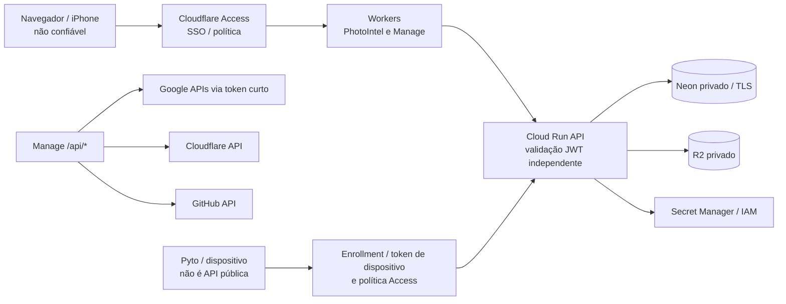
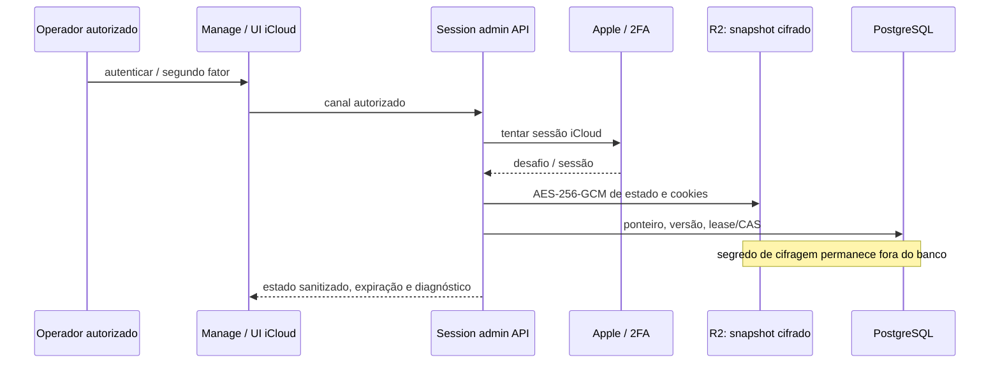

# Segurança, confiança, tokens, sessões e configurações

**Fonte de verdade:** `auth.py`, `apps/manage/src/auth.ts`, `infra/cloudflare/cloud-run-proxy/worker.mjs`, `config.py`, `session_store.py`, `bootstrap.sh`. Auditado em `22c01bc`.

## 1. Zonas de confiança

### Cloudflare Access

Produção exige assinatura RS256, `iss`, `aud`, expiração, presença de e-mail e allowlist. A API e o Manage verificam as credenciais **novamente**; o proxy não concede identidade privilegiada automaticamente. `apps/manage/src/auth.ts` consulta JWK do time, importa chave Web Crypto e verifica assinatura. O backend Python mantém sua validação. A ausência de JWT ou identidade permitida deve falhar fechado, inclusive quando alguém acessa diretamente o domínio público `run.app`.

No Manage, APIs com escrita exigem origem estrita para mitigar CSRF, além de JWT e regras de autorização. O Worker mantém credenciais somente no servidor, nunca em `dist` ou em resposta JSON. Browser não deve construir requisição direta com token GitHub/Cloudflare/GCP.

## 2. Segredos por fronteira

| Material | Armazenamento esperado | Consumo |
|---|---|---|
| `GCP_CONFIG_ENV` | GitHub Environment var `production` | opções **não secretas** e referências Secret Manager |
| `DATABASE_URL` | Secret Manager (runtime); conexão pooled/TLS | API e Jobs |
| `MIGRATION_DATABASE_URL` | Secret Manager separado | migração direta |
| `STORAGE_ACCESS_KEY` / `STORAGE_SECRET_KEY` | Secret Manager | R2 backend, não navegador |
| `ICLOUD_SESSION_KEY` | Secret Manager (referência no config) | criptografia AES-GCM de sessão Apple |
| `BRIDGE_TOKEN_PEPPER` e `BRIDGE_ENROLLMENT_SECRET` | Secret Manager | enrollment/credenciais revogáveis |
| Tokens GitHub, Cloudflare e Sentry do Manage | bindings Worker ou resolvidos por identidade/Secret Manager | integrações administrativas |
| `INFERENCE_SERVICE_TOKEN` | Secret Modal/runtime autenticado | inferência HTTP privada |
| FCM | identidade Google ADC com IAM adequado | envio FCM HTTP v1 |

O exemplo `infra/gcp/config.example.json` contém nomes e versões, **não** valores reais. `.env.example` e `.env.runtime.example` documentam desenvolvimento e runtime; não copiar secrets para `.env` versionado nem para o browser. O Manage pode criar container de secret e adicionar versões, mas somente com IAM apropriado e reconciliação de deploy. Exibir prefixo/sufixo de segredo no UI é recurso diagnóstico limitado, nunca substituto de política de acesso.

## 3. Sessões Apple

O fluxo usa `session_store.py` e `icloud_web_auth.py` para snapshots versionados com lock/lease. A sessão pode expirar, a API não oficial Apple pode mudar, 2FA e confiança de dispositivo dependem de conta real. Não registrar senha, cookies, tokens ou URL de mídia em Sentry/Cloud Logging/Telegram. Rotacionar `ICLOUD_SESSION_KEY` requer plano de transição das versões, não somente trocar string no Deploy.

## 4. Mídia, cache e risco de vazamento

- R2 é bucket **privado**, sem CDN pública de originais/derivados.
- `/v1/assets/*/media/*` aplica autenticação e streaming controlado; não expor URL R2 em frontend.
- O service worker `apps/web/public/sw.js` cacheia shell/assets públicos versionados. Deliberadamente **não cacheia** `/v1/*`, `/auth/*`, chamadas admin ou dados privados.
- EXIF sensível fica em metadados com controle de acesso, não em JPG/WebP de exibição.
- Os eventos sanitizados do edge aceitam apenas códigos, rotas agrupadas, tempos e correlation IDs. Logs completos precisam de privilégio e revisão contra dados pessoais.

## 5. Integridade e idempotência

Hash SHA-256 local, limites de tamanho, revisões, `object_intents`, leases, fencing e outbox formam barreiras diferentes. Um upload R2 não equivale a commit de recurso, e uma falha no Cloud Run não autoriza apagar qualquer objeto sem reconciliação. Ações Apple dependem de mapping/aprovação e confirmação no dispositivo; o servidor não pode inferir que um filename é a mesma foto.

## 6. Princípios operacionais

- Preferir WIF/OIDC a chave JSON de service account; separar bootstrap, deployer, API, Jobs, migrate e Manage.
- Restringir `Access audience`, e-mails permitidos, origin, métodos, rate limit e tamanho de body.
- Auditar quem pode **ler valores** e quem pode apenas **listar metadados** no Secret Manager.
- Lembrar que `roles/firebasecloudmessaging.admin` para API/Jobs é permissão GCP explicitada no bootstrap, não uma segunda credencial Firebase no frontend.
- Não imprimir `gcloud secrets versions access`, cookie Apple, dump do Environment, tokens de API, IDs sensíveis ou corpo de imagem.
- Distinguir falha de autenticação (401/403), falha de capacidade (409/422), erro de origem (503) e bug (500) antes de rotacionar segredos.

Referências adicionais: [CLOUDFLARE_SETUP](../../CLOUDFLARE_SETUP.md), [ICLOUD_SESSION_SETUP](../../ICLOUD_SESSION_SETUP.md), [DISASTER_RECOVERY](../../DISASTER_RECOVERY.md).
