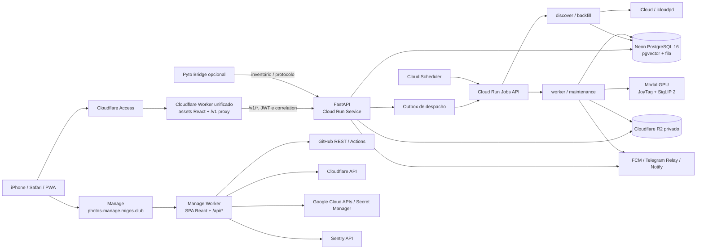
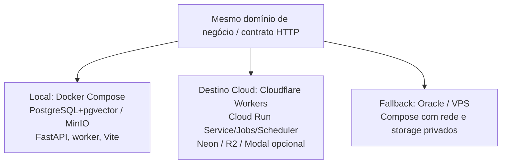

# Arquitetura do sistema e fronteiras de execução

**Estado do código:** 04/11/2026, commit `22c01bc`. **Alcance:** topologia implementada e intenção de deploy, não confirmação de recursos ativos em cloud.

## 1. Visão lógica

**Correção importante:** a publicação principal do frontend **não é necessariamente Cloudflare Pages**. O código atual usa `infra/cloudflare/cloud-run-proxy/worker.mjs` como Worker único para assets estáticos e relay da API, com configuração montada pelo workflow `deploy-worker.yml`. O Manage é **outro Worker** em `apps/manage/src/worker.ts`. O arquivo `apps/web/wrangler.preview.jsonc` é de **preview**, não a topologia final de produção.

## 2. Responsabilidade e fonte de verdade

| Componente | Executa | Guarda estado durável? | Arquivos principais |
|---|---|---|---|
| Worker PhotoIntel | distribui Vite `dist`, SPA fallback, autenticação de entrada via Access, `/v1/*` para origin fixo | não; apenas estado efêmero por isolate | `infra/cloudflare/cloud-run-proxy/worker.mjs` |
| Web | biblioteca, busca, jobs, galerias, controle de fila, notificações | UI/Cache local descartável | `apps/web/src/App.tsx`, `pages/*` |
| API FastAPI | autenticação, catálogos, contratos, criação/controle de trabalhos, mídia privada, diagnósticos | PostgreSQL/R2, nunca disco de Cloud Run como verdade | `apps/api/src/photointel/main.py`, `routers/*` |
| Cloud Run Jobs | etapas finitas, recuperação, manutenção e migração separada | checkpoints/leases/jobs no PostgreSQL | `services/task_runner.py` |
| Banco | IDs, manifests, scans, jobs, auditoria, usuários de Bridge, índices e vetores | sim | `models.py`, `infra/migrations/versions/*` |
| R2 | source_download e variantes privadas | sim, mas sem substituir catálogo | `storage.py`, `services/media.py` |
| Modal | runtime opcional de inferência autenticada | modelos em volume Modal; resultados são persistidos pela API/worker | `gpu/modal_app.py`, `gpu/service.py` |
| Manage Worker | consulta/aciona provedores, edita configuração e versões de secrets, investiga logs | APIs remotas; sem banco da aplicação | `apps/manage/src/api.ts`, `routes/*` |
| Apple Bridge | inventário/negociação para eventual sync aprovado | estado no backend + Keychain no dispositivo, sujeito a capacidade real | `bridges/pyto/bridge.py`, `routers/bridge.py` |

## 3. Regras fundamentais

1. **O UUID interno do asset não é o identificador iCloud.** Resource ID, PhotoKit local ID e cloud identifier são mapeamentos distintos. Nome e data não comprovam equivalência.
2. **API não é worker permanente.** Instâncias da API podem escalar a zero; trabalhos longos vivem em Cloud Run Jobs finitos.
3. **Trabalho persiste antes do disparo.** O outbox no PostgreSQL armazena a intenção; erro ao chamar Google Jobs API não apaga a operação.
4. **I/O fora de transações longas.** Apple, HTTP, R2, decode e Modal operam sem manter locks SQL durante o I/O. Resultado só é publicado após reconfirmar lease, fencing token e revisão.
5. **Derivados privados, originais preservados.** O projeto ingere representações configuradas do Apple e gera arquivos derivados; não é um backup integral do iCloud nem faz exclusão de originais.
6. **Cloudflare Access não substitui auth da API.** Tanto API quanto Manage verificam JWT e allowlists próprios. `run.app` ainda é alcançável pela rede pública.
7. **Flags de features são barreiras.** iCloud, GPU, escrita Apple e backfill grande não devem ser presumidos operacionais apenas por existirem rotas.

## 4. Topologia local, cloud e fallback

O Compose é ambiente de desenvolvimento e alternativa de hospedagem, não prova de que produção usa seus serviços. O Cloud Run não dispõe de filesystem persistente entre instâncias. Para escopo operacional e limites, leia [Infraestrutura](INFRASTRUCTURE_AND_DEPLOY.md), [Segurança](SECURITY_AND_SECRETS.md) e [Lacunas](IMPLEMENTATION_REFERENCE.md).

## 5. Caminhos críticos

- **Leitura de foto:** navegador → Access → Worker unificado → `GET /v1/assets/{id}/media/{variant}` → validação API → recurso privado R2 → streaming com ETag/Range; não cache público.
- **Ingestão:** `POST /v1/ingestion/start` → autorização → job/manifest/dispatch → descoberta Apple → job de download → metadados/derivados → análise, com retries isolados.
- **Controle:** `/v1/jobs/control/*`, `/v1/jobs/{id}/pause|resume|cancel`, `/v1/job-batches/*` alteram estado de fila durável.
- **Operação:** Manage → APIs de GitHub/GCP/Cloudflare/Sentry e Secret Manager, aplicando autenticação no Worker.
- **Push:** API guarda registros de instalação; eventos de jobs alimentam notificadores FCM/Telegram/Notify se configurados.

Estes são **fluxos do código**. Para afirmar execução real, verifique SHA implantado, identidade cloud, histórico de jobs, saúde do banco, bucket, sessão Apple e resposta do provedor.
