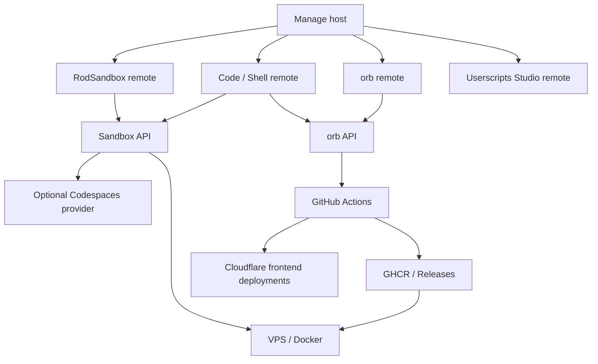
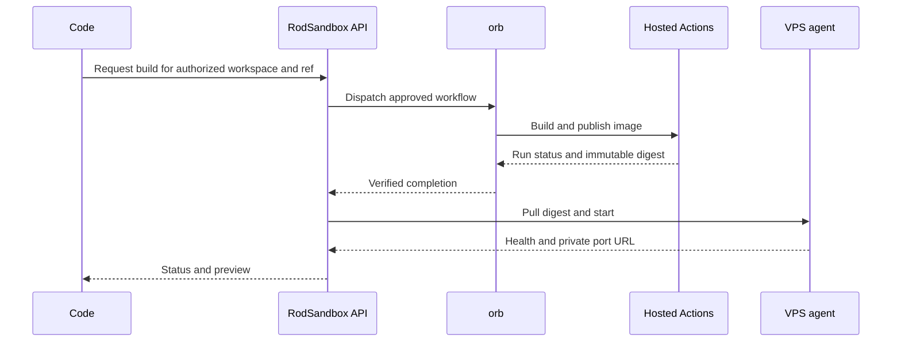

# Rodverse — Module Federation architecture

Status: approved product direction (2026-11-27). Experimental Sandbox/Manage implementation and local browser validation now exist; production rollout remains pending. See [implementation status/evidence](STATUS.md), [exported contracts](CONTRACTS.md), [registry](MODULE_REGISTRY.md) and [migration decisions](MIGRATION.md). The architecture below records approved direction and original audit; proposed sketches are superseded by those implementation documents where stated.

## Decision

Manage is the central user experience, not a central implementation. Code/Shell, orb, RodSandbox and eligible Userscripts Studio features each remain standalone and expose the same feature tree to Manage through Module Federation. No second UI implementation. RodSandbox owns execution environments, containers and ports; Codespaces is an optional provider, not the platform. Do not introduce a separate Runtime product.

## Evidence and ongoing work

| Source                                                                                                                                                                                                                        | Observed reality / next action                                                                                                                                                                                                                                                                                                                                      |
| ----------------------------------------------------------------------------------------------------------------------------------------------------------------------------------------------------------------------------- | ------------------------------------------------------------------------------------------------------------------------------------------------------------------------------------------------------------------------------------------------------------------------------------------------------------------------------------------------------------------- |
| [Manage package](../../../apps/manage/package.json), [Vite](../../../apps/manage/vite.config.ts), [README](../../../apps/manage/README.md)                                                                                    | React 19, Vite 8, TanStack Router/Query, Dexie, CodeMirror, React Flow, Tailwind/Radix; Vite config has no federation plugin. Existing independent Worker and Access authorization documented; README references photos-manage.migos.club, reconcile actual manage.migos.club deployment before migration.                                                          |
| [Shell main Vite](https://github.com/rodkisten/shell/blob/5ea80dce9b6ff68fb17ab8c2fb908105ca979874/vite.config.ts)                                                                                                            | Vite 7, React 19, Cloudflare plugin, React Router, WASM workers; no federation plugin in inspected config.                                                                                                                                                                                                                                                          |
| [Shell PR 28](https://github.com/rodkisten/shell/pull/28), [spec](https://github.com/rodkisten/shell/blob/feat/code-workflow-studio/AGENTS.md), [federation run](https://github.com/rodkisten/shell/actions/runs/45718850360) | Code monorepo specification and federation CI reference; actual branch artifacts and host integration require validation.                                                                                                                                                                                                                                           |
| [Shell Touch bridge](https://github.com/rodkisten/shell/blob/main/docs/vscode-touch-bridge.md)                                                                                                                                | iframe/postMessage protocol for future VS Code extension, not federation. Keep it isolated.                                                                                                                                                                                                                                                                         |
| [orb architecture](https://github.com/rodkisten/orb/blob/ac0d05e54796dbe957a88259078bd5fd430b80d1/docs/api-architecture.md), [PR 5](https://github.com/rodkisten/orb/pull/5)                                                  | API-first, injected services, scoped CSS, independent builder state. Compare actual builder code with Code before extraction; no parallel editor.                                                                                                                                                                                                                   |
| [uai](https://github.com/rodkisten/uai/blob/main/README.md)                                                                                                                                                                   | shadcn registry; source installation is not runtime federation. Documented hostname status requires verification.                                                                                                                                                                                                                                                   |
| [Userscripts RFC 138](https://github.com/rodkisten/userscripts-cf/pull/138)                                                                                                                                                   | Lazy module strategy; documentation only. Studio can federate; GM/Shadow DOM runtime stays independent.                                                                                                                                                                                                                                                             |
| [Shared CI](https://github.com/rodkisten/github) and [PR 11](https://github.com/rodkisten/github/pull/11)                                                                                                                     | Reusable pipelines and action bundle fix; GHCR central pipeline not established by audit.                                                                                                                                                                                                                                                                           |
| RodSandbox                                                                                                                                                                                                                    | Approved standalone + remote direction; [repository](https://github.com/rodkisten/rodsandbox) resolved; main is Next.js 16.2.6 + React 19.2.4, CodeMirror 6, xterm, IndexedDB/LightningFS, isomorphic-git, esbuild and node-pty dependencies. [PR #12](https://github.com/rodkisten/rodsandbox/pull/12) proposes Vite/Cloudflare migration; implementation pending. |

Main Rodverse audit observed commit 8a7af87a059ab887c24ee0d0c6c6a52fcf90c540; open PRs #261 and #257 concern CI, not federation. Do not overwrite concurrent work.

## Topology



Code owns editor/AST and proposed canonical Workflow Studio; orb owns registry, workflow execution, events and orchestration. Compare both branches and choose existing reusable implementation before moving code. Manage owns navigation, workspace selection, module registry and composition. uai owns semantic UI primitives. RodSandbox owns workspace files, terminal, resource inventory, process/container lifecycle, volumes and private port forwarding. github owns reusable CI. rodlog owns log formatting; rodtui CLI presentation. Preserve PhotoIntel and Jardim independent production infrastructure.

## RodSandbox migration alignment (2026-11-27)

Main [package.json](https://github.com/rodkisten/rodsandbox/blob/main/package.json) still declares Next.js and pnpm 8; README describes the CDN route rather than the complete sandbox. Do not mistake package dependencies for functioning file operations or terminal access. [PR #12 migration contract](https://github.com/rodkisten/rodsandbox/blob/refs/pull/12/head/docs/vite-cloudflare-migration.md) explicitly chooses React 19/Vite/TanStack Router, pnpm workspaces without Turborepo, Elysia and native Cloudflare handlers, esbuild WASM, import maps, TypeScript workers, CodeMirror 6 and UAI. It is stacked on #11; confirm predecessor merge and retarget/reconcile before changing the branch.

Extend that migration with standalone and federated entrypoints after extracting Next-specific routing/API dependencies. Preserve browser-first compilation, IndexedDB filesystem, declaration workers and preview isolation. Linux terminal/filesystem access goes through authenticated isolated remote gateway, not Workers host shell or paid Cloudflare containers. Browser workspace is not the same as VPS filesystem: expose provider capabilities explicitly, synchronize only on request and handle conflicts. Preserve existing CDN routes and audit server-only dependencies. No new Runtime repo. Avoid a second migration PR competing with #12. The official Vite federation guide explicitly supports Vite 5–8; validate exact installed versions together.

## Integration contract (proposed, not exported yet)

Each remote exports a React feature root without creating a second React root or assuming a host router. Standalone entry wraps that same feature root with local adapters. Manage mounts it within its own layout. Define a versioned TypeScript contract package in Rodverse, separate from UI source registry; publish only after compatibility proof.

```ts
interface RodModuleManifest {
  id: string;
  version: string;
  gitSha: string;
  contractMajor: number;
  entry: string;
  standaloneUrl: string;
  exposes: string[];
  capabilities: string[];
}
interface RodModuleContext {
  workspace: { id: string; repository?: string };
  navigate: (path: string) => void;
  location: { pathname: string; search: string };
  request: (capability: string, input: unknown) => Promise<unknown>;
  notify: (event: { title: string; message?: string }) => void;
  theme: { mode: 'light' | 'dark'; portalRoot: HTMLElement };
  signal: AbortSignal;
}
```

Use typed capability adapters and runtime schema validation instead of a general privileged token or arbitrary API proxy. Version request/response contracts, validate server side; backend remains authorization boundary. Route prefixes /shell, /orb, /sandbox and /scripts proposed; URL is canonical, preserve back/forward, deep links and query state. Standalone adapter owns local router, host adapter maps relative routes. Avoid nested BrowserRouter and shared global Zustand stores. Query cache keys scoped by module/workspace/user. Dexie namespaced by module and schema; standalone and federated origins have distinct IndexedDB, synchronize via authorized API only where necessary. Unmount aborts network/worker subscriptions, removes listeners and portals, preserves intentional drafts.

## Build and runtime selection

Evaluate @module-federation/vite with actual Vite 7 Shell and Vite 8 Manage lockfiles; compare existing federation branch before choosing migration. Official references: [Vite integration](https://module-federation.io/integrations/build-tool/vite.html), [runtime API](https://module-federation.io/guide/runtime/runtime-api), [plugin](https://github.com/module-federation/vite). Use generated mf-manifest.json and explicit ESM remote type; host registry is separate business manifest. Register approved remotes lazily with runtime API, load one stable expose, e.g. ./App. Share compatible React/react-dom and JSX runtime subpaths as singleton where supported; verify actual identity in browser. Share CodeMirror state/view only where objects cross boundary, otherwise keep local. Avoid experimental fixed import-map mode because dynamic runtime registration is required. No broad eager sharing. Scoped CSS, no remote global reset, host semantic tokens and configurable Radix portals; inspect CSS ordering and WASM worker asset URLs. Use absolute remote asset base or validated manifest paths. Avoid nesting remotes unnecessarily.

Registry maintains module ID, enabled flag, production/PR/dev selection, reviewed immutable build URL, SHA, compatible contract, last known good version, status and standalone link. Only approved origin and artifact paths, no arbitrary user-supplied executable URL. Pin a remote for the session; switching versions reloads the page, not a promise of hot replacement. Lazy loading, timeout, retry, per-module error boundary, standalone fallback, diagnostic request IDs. Measure JS transfer, initial load, mount time and memory on iOS Safari.

## Security

Federation is NOT isolation: remote code runs with host origin privileges. Production host only loads reviewed trusted releases; untrusted PR previews use isolated preview host or sandboxed iframe, never privileged production host. Access JWT audience, issuer, signature and allowlists verified independently by API. Never hand browser GitHub App keys, Docker socket, CF service token or GCP credentials. CORS for approved host origins, explicit credentials only where required; test manifest/chunk requests under Access (login HTML instead of JS, 401/403, MIME, CSP, redirects). Consider same-origin authenticated asset proxy restricted to approved artifact paths, not an open proxy. CSP defense in depth, not isolation from trusted remote. Preview write restrictions and separate credentials remain enforced server-side. iframe reserved for untrusted previews, sandbox content and existing VS Code Touch bridge; validate origin/source and schema in postMessage.

## CI, versions and rollout

Each remote builds standalone HTML + federated artifacts, validates typecheck and necessary contract/runtime unit tests, publishes immutable SHA-addressed chunks and manifest before updating stable pointer atomically. Cache immutable chunks long-term, mutable pointers short/no-cache; retain previous builds for rollback and old sessions. Existing Manage PWA service worker must not serve obsolete remote manifests or precache arbitrary remote URLs. Single preview per PR and sticky editable comment. Shared workflows in rodkisten/github after fixing bundles; concurrency cancellation per PR/ref, trusted publish separate from untrusted checks, least privilege. Production rollback reselects last compatible manifest. No host rebuild needed for compatible remote release. No claim of live deployment until browser smoke verified.

## Remote execution



Hosted runners perform heavy npm/pnpm/Cargo/Go builds; GHCR immutable image digests for services; prebuilt release binaries for CLI where appropriate. VPS pulls and runs; no automatic local build fallback. Use Docker Compose no-build deploy, staged health check, resource limits, rollback, persistent volumes, disk quotas and explicit cleanup. Agent narrowly authorized for named services; Docker socket is root-equivalent and never publicly exposed. No privileged containers by default. Build inputs include repository, immutable ref, environment, target, idempotency key; return run URL immediately, stream logs through authorized API. Unsaved local changes require explicit safe source snapshot or commit before CI, never upload secrets by default. Provider capability differences visible in UI.

Ports: localhost on iPhone is iPhone, not VPS. Bind service appropriately inside container and expose only through authorized gateway / Cloudflare Tunnel + Access; wildcard DNS alone is insufficient. Map workspace/service/port to approved target, verify identity and workspace ownership on every request and websocket upgrade, no arbitrary internal destinations, expiration/revoke and audit. HMR websocket and relative API URLs must be tested. Separate preview origins from privileged Manage cookies and APIs. Reuse existing gateway if its code and security contract support it.

## Implementation order / acceptance

1. Inspect RodSandbox migration PR and predecessor merge status, inspect all active PR heads and federation workflow artifacts; confirm Manage deployed hostname and existing route inventory.
2. ADR and compatibility spike: one shared contract, Shell as first remote; local standalone and actual Manage host must both work. Preserve /touch, WASM, existing deploys.
3. Compare Code/orb workflow builders and extract one implementation; no new competing editor. Integrate uai primitives.
4. RodSandbox standalone and federated root, file operations, terminal/provider adapters; inventory existing capabilities first.
5. Registry + immutable manifests, preview isolation, authentication, rollback and diagnostics.
6. Shared hosted builds/GHCR and controlled pull agent; private Ports UI and live smoke from Safari.
7. orb and Userscripts Studio integration, retiring duplicated Manage screens only after parity.

Acceptance: typecheck host/remotes; unit tests only for meaningful contracts/parsers/authorization utilities; manual Chrome and iOS Safari standalone + embedded smoke; deep links/back, workspace changes, dialogs/portals, offline and remote failure, auth expiry, incompatible versions, PR isolation, independent deploy and rollback; full build and logs verified. Never mark planned functionality shipped. Sync main, inspect existing PRs, use large coherent changes; intermediate [skip ci], final [deploy] for implementation, docs-only change must not trigger production deployment. Use configured GitHub App where available and record actual identity; no invented conversation URL.

## Audit limits

No live deployments, CI artifacts, VPS or RodSandbox runtime implementation verified in this increment; package metadata and migration specification inspected. Search index is default-branch only. Architecture and contract sketches are proposals; exact package versions, DNS, routes, APIs and security behavior remain subject to implementation review.
