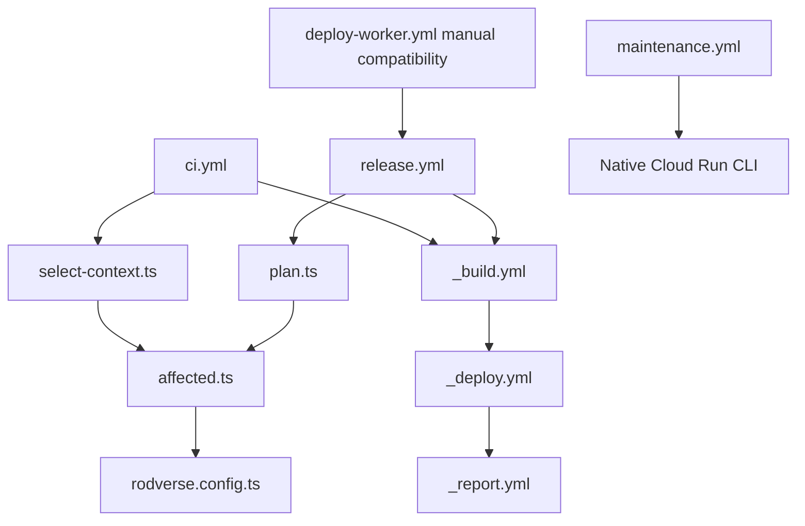

# Rodverse CI/CD — operational contract

Status: migration branch / PR #260, 2026-11-26. The YAML on the current ref is authoritative. Do not treat this guide as evidence of production deployment. Legacy GCP, preview, migration and validation workflows still coexist.

## Architecture



The arrow from build to deploy applies only to release, not CI. The frontend release orchestrator does not deploy the Python API. Terraform owns Cloud Run services and jobs; database migrations remain separately authorized.

## Entry points

| File | Contract |
| --- | --- |
| [ci.yml](../../.github/workflows/ci.yml) | Select affected validation jobs; no production credentials |
| [release.yml](../../.github/workflows/release.yml) | Frontend plan, build, conditional publication, aggregate report |
| [maintenance.yml](../../.github/workflows/maintenance.yml) | Manual offline validation and synthetic infrastructure plans |
| [deploy-worker.yml](../../.github/workflows/deploy-worker.yml) | Manual compatibility wrapper; no independent automatic triggers |

Release PRs validate but do not publish production. On main, Photos is automatically eligible when affected; Manage publication remains manual. Production jobs use the protected production environment. PR concurrency cancels superseded runs; production uses a shared concurrency group without cancel-in-progress. Existing preview workflow is separate.

## Dispatch (after merge and validation)

```sh
gh workflow run release.yml -R rodverse/rodverse --ref main -f app=manage -f action=build-and-deploy
gh workflow run release.yml -R rodverse/rodverse --ref main -f app=web -f action=build
gh workflow run maintenance.yml -R rodverse/rodverse --ref main -f operation=validate
gh run list -R rodverse/rodverse --workflow release.yml
```

Release inputs: app all/web/manage; action build/build-and-deploy; optional full source sha; optional request_id for correlation. Historical SHA selection is not a generic rollback or promotion API. Verify source authorization and configuration compatibility. Existing clients may continue dispatching deploy-worker.yml during migration.

## Reusable workflow contracts

| Workflow | Inputs | Result |
| --- | --- | --- |
| _build.yml | apps JSON array, production boolean=false, action=build, sha='' | Matrix validation and build; production artifact only for eligible release |
| _deploy.yml | apps JSON array, sha='' | Main-only protected deployment consuming same-run artifacts |
| _report.yml | apps, plan, build, deploy, notify=false | Aggregate phase results and optional notification |

The composite frontend-build action accepts app web/manage and phase install/validate/build. It runs npm ci, lint/typecheck/test, and build respectively. Validation aggregates failures. PWA and Worker checks remain application-specific. Shared definitions do not imply cross-run build reuse.

## Planner and new apps

rodverse.config.ts defines app root, provider, artifact directory and dependencies. affected.ts resolves changed paths with a conservative all-app fallback when Git diff is unavailable. plan.ts selects release apps; select-context.ts selects CI scopes. Shared changes can intentionally select both apps.

To onboard an app, update the manifest, planner scope rules, frontend-build allowlist, reusable workflow app-specific branches, artifact configuration keys, adapter, path triggers and tests together. Do not assume manifest-only registration is supported. Confirm npm scripts and lockfile, then validate PR and production-like offline paths.

## Configuration and identity

Use production vars.GCP_CONFIG_ENV as configuration input. packages/env/src/deploy.ts renders local config; browser env scripts expose only intended public build variables. Never upload config.local.json or log raw credentials. Cloudflare publication uses GitHub environment secrets, including CLOUDFLARE_ACCOUNT_ID and CLOUDFLARE_API_TOKEN. Manage has dedicated runtime credentials (see _deploy.yml for explicit mapping). Photos uses GCP Workload Identity to discover the API origin; Manage does not need GCP authentication for its Worker publication. Runtime Cloud Run secrets remain pinned Secret Manager references. Do not grant extra IAM to work around unrelated failures.

## Artifact contract

Production artifacts are named app-sourceSHA-runID and retained seven days. frontend-artifact.ts seals dist with .rodverse-artifact.json containing schema version, app, source SHA, workflow SHA, run ID, public configuration fingerprint and content digest. Deployment reconstructs public configuration, checks the metadata and digest, then removes the manifest before publication. A mismatch must fail closed. This is an integrity check within a trusted workflow, not a cryptographic signature or cross-run promotion mechanism. No raw secret values belong in the manifest. Header injection after verification is a separate trusted deployment step.

## Native Cloud Run tooling

```sh
node scripts/ci/cloud-run/index.ts --help
node scripts/ci/cloud-run/index.ts render --config infra/gcp/config.local.json
node scripts/ci/cloud-run/index.ts jobs-plan --config infra/gcp/config.local.json
node scripts/ci/cloud-run/index.ts scheduler-plan --config infra/gcp/config.local.json
```

Node 26 runs TypeScript directly. render writes local files. jobs-plan and scheduler-plan print plans only. build and doctor default to no remote execution; remote execution requires --apply --authorize-charges --confirm-project PROJECT. Direct service deployment, scheduler mutation and migration are not exposed by this CLI. Existing scheduler names must be supplied for update planning; never execute generated plans blindly.

Maintenance dispatch options: validate, render, jobs-plan, scheduler-plan. It uses synthetic fixture configuration, no cloud authentication, no production environment, no resource mutations. It does not replace real GCP health or Terraform operations yet.

## Reports and troubleshooting

Inspect the GitHub run summary and exact commit SHA. Plan, build and deploy are distinct outcomes. Skipped deployment is not publication success. The aggregate notification is best-effort and requires homologation. PR comments and live activity lifecycle are not yet consolidated.

If a workflow is absent, check YAML syntax, reusable workflow permissions, trigger paths and default-branch registration. If artifact verification fails, inspect source SHA, public config inputs and artifact run ID; never bypass verification. If production deployment fails, keep the previous version and inspect adapter logs; do not blindly rerun migrations.

## Migration gates

- Verify CI and reusable workflow jobs actually execute, not merely that unrelated checks pass.
- Verify legacy dispatch, production environment access, artifact seal/verify, and notification end-to-end.
- Audit all references before deleting Python orchestration. Keep Python application, AI/media and migration code.
- Keep renderer parity until native config and manifest behavior are proven.
- Migrate Manage workflow consumers and operational docs before removing compatibility wrapper.
- Cross-workflow artifact reuse, production maintenance consolidation and final legacy deletion remain pending.

No production deployment or merge is implied by this document.

## Manage integration

The curated Deploys view now exposes release.yml and maintenance.yml. The provider supplies explicit dispatch choices for both, and retains the legacy frontend dispatch schema. Worker configuration reconciliation selects release.yml with app=web and action=build-and-deploy. Existing Manage-specific reconciliation and Terraform release console remain legacy consumers pending migration.

## Release console compatibility

The legacy Terraform release console dispatches release.yml in rodverse/rodverse and checks the requested publication job after a successful run. Last-published source selection requires the actual Worker source binding; workflow head SHA is not a safe substitute for a historical source SHA. The Python console remains until API/media build and Terraform dispatch parity is established.

Native catalog.ts now supports API and paired media inventories, full SHA tags, newest common source selection and Git ancestry checks. It rejects dry-run inventory as evidence. The Python console is not switched to this module yet; parity and integration remain migration gates.

Native dispatch.ts provides a main-only confirmed frontend dispatch using gh, unique request IDs, bounded polling and explicit job verification. It never retries a POST automatically. It is not yet wired into the production console; validate against a real authorized dispatch before switching consumers.

Native CLI media-build now submits the paired media Cloud Build configuration and verifies both immutable digests for the selected SHA. It defaults to dry-run; real submission requires the existing explicit project/charge authorization. The legacy console still owns pre-build media validation and Terraform/database gates; do not switch production callers until those checks are integrated.

Native terraform.ts validates dispatch inputs and preserves the existing read-only Neon/Alembic gate for API apply. Historical API apply is rejected until source-specific schema verification exists. Terraform remains the mutation owner; the module is not yet the production entrypoint. The database verifier intentionally retains Python application migration dependencies.

The native release-console.ts composes selection, ancestry, frontend dispatch, API build, registry digest verification and Terraform apply. It is an importable staging module, not the production entrypoint. Historical execution, frontend deploy-only and media build are deliberately blocked pending isolated source/preflight parity. Plan selection is offline and does not dispatch Terraform. Production callers remain unchanged.

Native builds now run in disposable detached worktrees with ancestry verification and cleanup. Media preflight requires committed npm lockfiles and runs install, build and tests for image and video before submission. Historical execution remains blocked pending trusted-source policy and schema verification. The production workflow remains on the legacy entrypoint.

Offline rehearsal: `node scripts/ci/cloud-run/release-preview.ts --target media --action build-and-deploy` prints selection and ancestry-validated intent without calling cloud or GitHub APIs. The parity workflow exercises all sixteen target/action combinations. This is selection rehearsal, not proof of production execution support. Media build verification now includes Imagor alongside image and video; Terraform media job deployment still verifies its two job images only.

Compatibility correction: preserve the original release.yml operator console (api/media/web/manage/all, source, action, SHA and confirmation). Frontend orchestration moves to frontend-release.yml; deploy-worker.yml remains its compatibility wrapper. The console exposes engine=preview for offline selection rehearsal, skipping cloud authentication and mutation. Legacy remains the default. Preview is not authenticated execution.

Authenticated verification: engine=verify checks the active downstream workflow using GitHub App credentials and inventories Artifact Registry for API/Media using read-only runner mode. No dispatch or build occurs. Manage exposes the separate console and frontend contracts. Confirmation defaults to false. Native mutation remains disabled pending verification.
